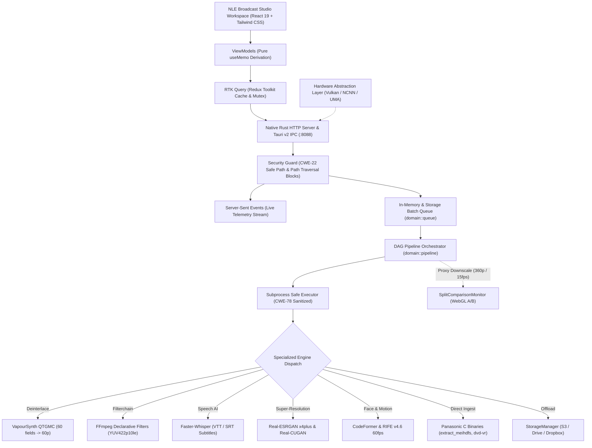
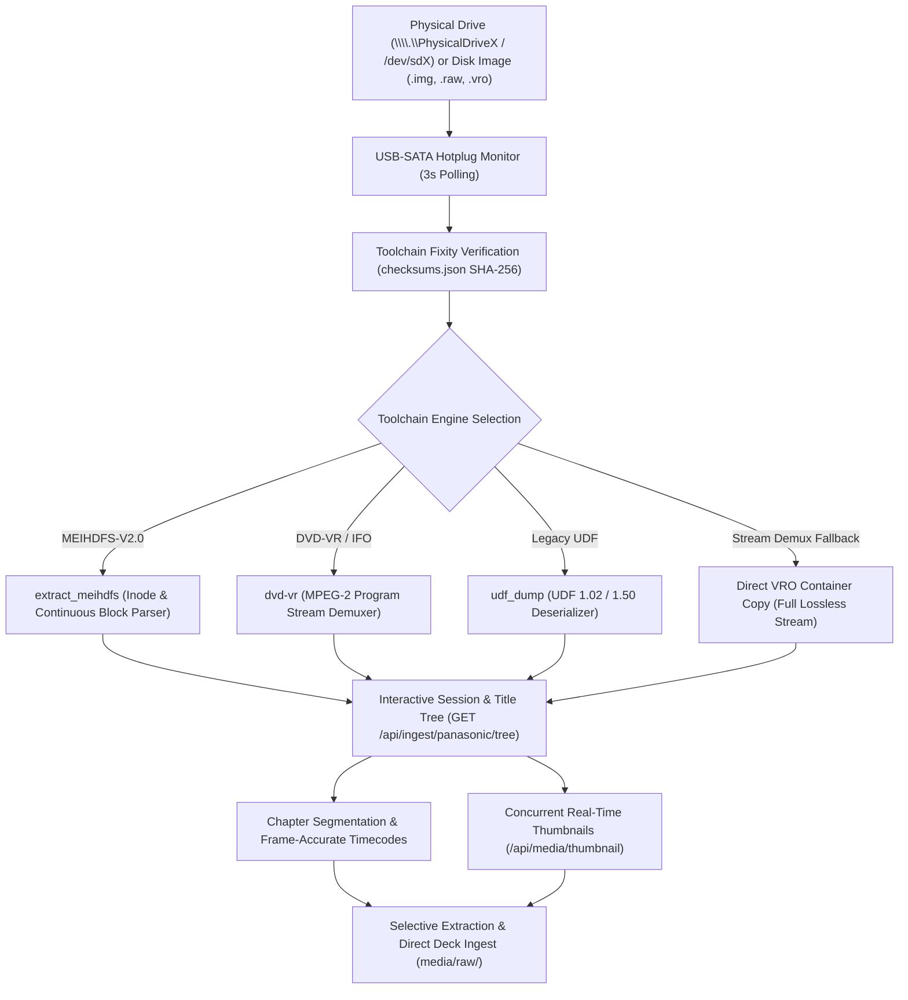
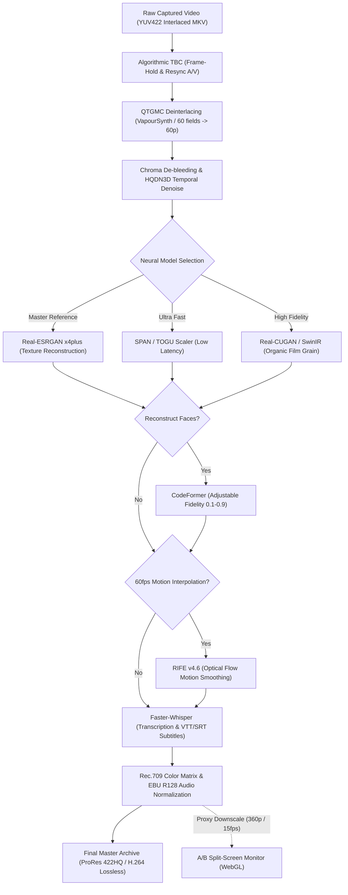

# 📼 VHS Studio Pro - Archival Analog Capture & Neural Restoration Platform

[](#-automated-quality-gates--cicd) [](#-automated-quality-gates--cicd) [-brightgreen.svg>)](#-security--threat-model)

[](#-desktop--web-pro-interface) [-blue.svg>)](#-desktop--web-pro-interface) [](#-compliance--license-agreement)

---

**VHS Studio Pro** is an archival-grade, forensic-level open workstation engineered for the end-to-end digitization, timebase stabilization, mechanical jitter mitigation, and multimodal neural enhancement of legacy analog magnetic tape media (**VHS, S-VHS, VHS-C, Video8, Hi8, and Betamax**).

Built upon a **Concurrent Directed Acyclic Graph (DAG) Pipeline Engine**, the system orchestrates low-latency ingestion via OBS Studio (WebSocket v5), bit-level forensic extraction from standalone **Panasonic DVR hard drives (MEIHDFS-V1.0 / MEIHDFS-V2.0 / DVD-VR)**, reference broadcast-standard motion-compensated deinterlacing (**VapourSynth + QTGMC**), mathematical software Time Base Correction (**TBC Frame-Hold**), offline multilingual AI speech transcription and subtitling (**Faster-Whisper**), neural texture super-resolution (**Real-ESRGAN x4plus** / **Real-CUGAN**), neural facial reconstitution (**CodeFormer**), optical-flow motion interpolation (**RIFE v4.6 60fps**), zero-overhead real-time **A/B Split-Screen comparison monitoring**, and secure local/cloud offloading (**AWS S3, Google Drive, Dropbox**) with cryptographic BagIt fixity verification.

---

## 📑 Table of Contents

- [Overview &amp; Core Highlights](#-overview--core-highlights)
- [System Architecture](#-system-architecture)
  - [Panasonic DVR Ingest &amp; Cryptographic Fixity](#-panasonic-dvr-forensic-ingest-pipeline--cryptographic-fixity)
  - [Multi-Model Neural DAG Pipeline](#-multi-model-neural-restoration-dag-graph)
- [Hardware Abstraction Layer (HAL) &amp; Tiers](#-hardware-abstraction-layer-hal--honest-performance-tiers)
- [Canonical Studio Restoration Presets](#-canonical-studio-restoration-presets)
- [Desktop &amp; Web Pro Interface](#-desktop--web-pro-interface)
- [Security &amp; Threat Model](#-security--threat-model)
- [Compliance &amp; License Agreement](#-compliance--license-agreement)
- [Automated Quality Gates &amp; CI/CD](#-automated-quality-gates--cicd)
- [Installation &amp; Quick Start](#-installation--quick-start)
- [In-Depth Documentation Index](#-in-depth-documentation-index)

---

## 🚀 Overview & Core Highlights

- **Sequential Pipelined Chain with Graceful Degradation:** A cumulative multi-engine post-processing chain (`FaceRestoration` $\to$ `RIFE 60fps` $\to$ `Real-ESRGAN`) passing state cumulatively with atomic file commit (`os.replace`) and cleanup of intermediate temporary files. Per-step error boundaries guarantee that secondary neural failures gracefully preserve the base master without crashing the studio.
- **Real-Time Hardware Telemetry & Dynamic Sparklines:** Real-time host CPU and RAM utilization tracking via `psutil` (`GET /api/system/metrics`), exposed through an interactive retractable drawer in the NLE Footer StatusBar with live CSS sparkline load histories and color-coded threshold alerts.
- **Automated Tape Quality Control & Forensic Defect Reporting:** Automated inspection (`QualityControl.run_qc`) that detects unrecorded black leaders, interlacing cadence, audio channel disparity, magnetic oxide dropouts, and head switching noise, generating structured JSON and Markdown defect reports for any file in the archive.
- **Interactive Real-Time A/B Split-Screen Monitor:** Real-time dual-frame inspection powered by a lightweight 360p/15fps proxy pipeline (< 50ms latency, < 2% CPU overhead). Standard 4:3 VHS tapes receive automatic pillarbox padding to prevent anamorphic stretching, while client disconnects trigger recursive `psutil` process tree killing to eliminate orphaned FFmpeg processes on Windows.
- **Hardware Abstraction Layer (HAL) & UMA Optimization:** Probes host CPU topology, system RAM, discrete GPUs, and Unified Memory Architecture (UMA) on integrated graphics (Intel UHD Graphics 770 / Iris Xe / AMD Radeon). Binds tensor workloads directly to Vulkan NCNN (`-g 0`) while offloading final rendering to dedicated fixed-function silicon encoders (Intel QuickSync `h264_qsv`, AMD AMF, NVIDIA NVENC, or Apple Silicon VideoToolbox).
- **Algorithmic TBC Frame-Hold:** A mathematical software time base corrector that locks damaged horizontal/vertical sync pulses without dropping continuous audio samples. This eliminates cumulative A/V desynchronization even when playing back tapes with severe physical creasing, shedding oxide, or mold contamination.
- **Broadcast-Standard Motion-Compensated Deinterlacing:** Native integration with **VapourSynth + QTGMC** (presets ranging from *Slower* to *Faster*), synthesizing 59.94/50 temporal fields per second into clean, progressive 59.94p/50p frames free of bob shimmer. Provides robust fallback to FFmpeg's directional `bwdif`, `znedi3`, or `yadif`.
- **Non-Destructive Process Management & Crash Recovery:** Real-time process suspension via OS signals (`SuspendThread` on Windows, `SIGSTOP` on POSIX) drops CPU/GPU usage to 0% instantly. Provides deterministic resume (`ResumeThread` / `SIGCONT`), safe cascade termination, and automatic container repair (`-c copy -movflags +faststart`) for incomplete recording jobs (`.tmp.mp4` / `.tmp.mkv`).
- **Symmetric Non-Blocking Terminal Workstation (TUI):** Fully interactive, non-blocking terminal experience featuring zero-browser, keyboard-driven navigation across Linux/macOS (POSIX `termios` / `select`) and Windows CRT (`msvcrt.kbhit()` / `msvcrt.getch()`).
- **Comprehensive Multimodal Neural Suite:**
  - **Faster-Whisper:** End-to-end multi-language speech recognition, acoustic timestamp alignment, synchronized `.vtt` / `.srt` subtitle generation, and deterministic `try ... finally` WAV cleanup.
  - **Real-ESRGAN x4plus & Real-CUGAN:** Deep convolutional neural super-resolution networks tailored for edge reconstruction, analog blur elimination, and organic film grain preservation.
  - **CodeFormer:** Blind face restoration network with adjustable fidelity weighting (`0.1` to `0.9`), reconstituting distant facial contours without synthetic plastic artifacts.
  - **RIFE v4.6:** Bidirectional optical flow motion interpolation, elevating 25p/30p video to cinematic 60fps fluid motion.
  - **FFmpeg Scene Cut Detection:** Algorithmic scene change detection and chapter segmentation (`src/domain/chapters.rs`) based on luminance content shift.
- **Deterministic Functional Batch Queue:** Industrial-grade FIFO queue manager (`src/domain/queue.rs`) with immutable job state persistence, dynamic priority ordering, error isolation, and host overload throttling.
- **Archival Cloud Connectivity:** Asynchronous offloading to AWS S3, Google Drive (OAuth2 PKCE), and Dropbox with BagIt checksum manifests and preservation metadata.
- **Zero-Hardcode Internationalization (10 Locales):** Complete out-of-the-box localization supporting `pt-BR`, `en-US`, `es`, `fr`, `de`, `it`, `ja`, `ar` (with RTL structural layouts), `ru`, and `zh-CN`.

---

## 🏛 System Architecture

The software adheres to **Strict MVVM (Model-View-ViewModel)**, **Functional Core / Imperative Shell (FP Core)**, **Separation of Concerns (SoC)**, and **Single Source of Truth (SSOT)** design principles:



---

### 📀 Panasonic DVR Forensic Ingest Pipeline & Cryptographic Fixity

The forensic ingest subsystem accesses proprietary Panasonic DVR file systems directly at the raw block level (**MEIHDFS-V1.0**, **MEIHDFS-V2.0**, and **DVD-VR**), bypassing OS file-system drivers and preventing accidental formatting prompts:



---

### 🧠 Multi-Model Neural Restoration DAG Graph

The mastering engine coordinates neural models and DSP video filterchains in a concurrent, error-isolated DAG pipeline:



---

## 💻 Hardware Abstraction Layer (HAL) & Honest Performance Tiers

The Hardware Abstraction Layer ([`src/infrastructure/hardware.rs`](file:///c:/Users/danie/Documents/vhs-capture-scripts-main/src/infrastructure/hardware.rs)) probes host capabilities and classifies the environment into four honest tiers without exaggerated performance claims:

| Tier             | Classification                  | Hardware Profile Requirements                                                                            | Recommended Execution Profile                                                                                                  |
| :--------------- | :------------------------------ | :------------------------------------------------------------------------------------------------------- | :----------------------------------------------------------------------------------------------------------------------------- |
| **Tier 4** | **AI Workstation**        | Dedicated GPU$\ge$ 6GB VRAM (NVIDIA RTX / AMD Radeon RX)                                               | Full Neural Suite: QTGMC Slower, Real-ESRGAN x4plus, CodeFormer, RIFE 60fps, Whisper Large, NVENC/AMF Lossless                 |
| **Tier 3** | **Modern PC**             | Discrete GPU$<$ 6GB VRAM or Apple Silicon M-Series (Metal)                                             | Balanced AI: QTGMC Fast, Real-CUGAN / Vulkan NCNN, CodeFormer (targeted), Whisper Base/Small, Hardware Encoders                |
| **Tier 2** | **Multi-Core CPU + iGPU** | $\ge$ 8 Logical CPU Cores or Integrated GPU (Intel UHD 770 / Iris Xe / AMD Vega) with $\ge$ 16GB RAM | Real-time DSP: BWDIF / Lanczos (~60–120 fps), DeepFilterNet audio cleanup, Faster-Whisper Tiny/Base, CPU CRF 16–18           |
| **Tier 1** | **Basic PC**              | Dual/Quad-Core CPU with$\le$ 8GB RAM, Software Graphics                                                | Lightweight Archive: BWDIF / yadif single-pass deinterlacing, x264 CRF 18 Ultrafast, Whisper Tiny, Sequential Batch Processing |

---

## 🎛 Canonical Studio Restoration Presets

VHS Studio Pro provides four production-ready, empirically calibrated restoration profiles ([`vhs_advanced_config.toml`](file:///c:/Users/danie/Documents/vhs-capture-scripts-main/vhs_advanced_config.toml)):

1. **Broadcast Standard (`gold`):** Reference archival fidelity. Employs VapourSynth QTGMC (*Slower* preset) for progressive 60p/50p output, spatial chroma correction (`chroma_shift_x = -2`), software TBC frame-hold, and mastering in ProRes 422 HQ or H.264 CRF 18.
2. **Hardware Ultrafast (`speed`):** High-speed batch digitization throughput (render speeds exceeding 300–500 fps). Utilizes FFmpeg native `bwdif` deinterlacing with hardware acceleration (NVENC, Intel QuickSync `h264_qsv`, or AMD AMF) and Lanczos 1080p scaling at CRF 22.
3. **TBC Frame-Hold (`tbc_hold`):** Engineered for damaged, warped, or mold-contaminated tapes. Activates the mathematical frame-hold dropout shield, direction-interpolating `znedi3`, and mono-channel phase locking to completely prevent audio/video drift without dropouts.
4. **AI Master (`ai_master`):** Flagship neural restoration chain for 4K modern displays. Combines QTGMC deinterlacing, Real-ESRGAN x4plus texture super-resolution, CodeFormer facial reconstruction, and Faster-Whisper subtitling at CRF 16.
5. **Custom Pipeline:** Complete granular control over resolutions (480p, 720p, 1080p, 4K), noise filters (HQDN3D, NLMeans), audio gates, and specialized AI models via the Pro Settings panel.

---

## 🎨 Desktop & Web Pro Interface

The user interface is engineered according to professional non-linear editing (NLE) and broadcast control room specifications:

- **NLE Footer StatusBar & Telemetry Ribbon:** A fixed bottom status ribbon consolidating hardware tally indicators, tape title, frame-accurate counters, real-time FPS, ETA timers, rendering speed multiplier, and a non-intrusive collapsible diagnostic console drawer.
- **Top 2.5px Render Stripe:** An ultra-thin animated gradient stripe along the window's upper border (`sky-400` → `emerald-400` → `indigo-400`) providing immediate visual feedback during rendering without cluttering active toolbars.
- **Default "Ready Modes" Workspace:** Bypasses cryptic engineering terms, launching directly into clear restoration operational strategies (*Broadcast Standard*, *Hardware Ultrafast*, *TBC Frame-Hold*, and *AI Master*).
- **Accessible Sonner Toast System:** Rich operational feedback notifications with keyboard dismissal, action triggers, and dynamic progress transitions.
- **Framer Motion Fluid Transitions:** Contextual animations honoring the user's OS accessibility settings (`prefers-reduced-motion`).
- **WCAG 2.1 Level AAA Accessibility:**
  - 100% full keyboard navigation featuring prominent focus rings (`focus-visible:ring-2 focus-visible:ring-emerald-500`).
  - Comprehensive ARIA landmark attributes (`role="status"`, `role="progressbar"`, `aria-live="polite"`, `aria-live="assertive"`).
  - High-contrast color palette calibrated for darkened mastering suites and control rooms.
- **10-Language Internationalization (i18n):** Complete localized interface with zero hardcoded UI strings, supporting English, Portuguese, Spanish, French, German, Italian, Russian, Japanese, Simplified Chinese, and Arabic (with mirrored RTL layouts).

---

## 🛡 Security & Threat Model

VHS Studio Pro implements rigorous defensive controls against vulnerabilities common to hybrid desktop applications:

- **Command Injection Prevention (CWE-78):** Absolute elimination of shell execution. All external tool invocations pass sanitized, structured argument lists (`Vec<String>`) through the pure executor (`src/infrastructure/executor.rs`).
- **Path Traversal Guard (CWE-22):** The canonical validator [`is_safe_relative_asset_path`](file:///c:/Users/danie/Documents/vhs-capture-scripts-main/src/infrastructure/http_server.rs) neutralizes null bytes (`\0`), traversal sequences (`..`), and blocks access outside designated working directories.
- **Localhost Network Isolation & CSRF Mitigation:** The API listens exclusively on `127.0.0.1:8088`. Inbound requests validate `Host` and `Origin` headers against DNS rebinding, and all mutating actions require a cryptographic 32-character session token (`X-Session-Token`).
- **100% Offline Data Sovereignty:** Video frames, audio tracks, transcriptions, and metadata never leave the local workstation. Cloud transfers occur solely when the operator explicitly inputs private credentials.

Detailed specifications are available in [**docs/SECURITY.md**](docs/SECURITY.md).

---

## 📜 Compliance & License Agreement

Modeled on forensic software and low-level data recovery licensing standards:

1. **Grant of Use:** Free of charge for personal, educational, corporate, museum, and institutional forensic archiving purposes.
2. **Redistribution:** Unmodified packages and source archives may be freely redistributed provided this agreement is included.
3. **No Warranty:** Provided **"AS IS"** without warranties of merchantability or fitness for fragile physical analog media.
4. **Limitation of Liability:** The authors assume no liability for tape head wear, magnetic ribbon degradation, or hardware malfunctions.
5. **Operator Responsibility:** Operators remain solely responsible for evaluating tape condition, equipment cleanliness, and verifying output integrity.
6. **Local Execution:** Guarantee of strictly offline execution and zero data telemetry.

The complete agreement is located in [**docs/COMPLIANCE_LICENSE.md**](docs/COMPLIANCE_LICENSE.md).

---

## 🚦 Automated Quality Gates & CI/CD

Codebase integrity is enforced through **9 parallel automated Quality Gates** verified on every commit and GitHub Actions run:

```text
[1. Anti-Plagiarism / Code Duplication (JSCPD 0% - Zero Tolerance)]  ✅ PASSED
[2. UI Linter (Oxlint / ESLint)]                      ✅ PASSED
[3. TypeScript Build Compilation (TSC)]               ✅ PASSED
[4. React Component Tests (Vitest)]                   ✅ PASSED
[5. End-to-End Integration Tests (Playwright)]        ✅ PASSED
[6. Cargo Check (Rust Compilation)]                   ✅ PASSED
[7. Cargo Clippy (Rust Quality & Safety)]             ✅ PASSED
[8. Native Rust Unit Tests (Cargo Test)]              ✅ PASSED
[9. Translation Key Parity (10 Locales)]              ✅ PASSED
```

Run all quality checks locally:

```bash
node scripts/lint.mts
```

Execute the full 7-dimension architectural swarm audit:

```bash
node scripts/swarm_auditors.mts
```

---

## ⚡ Installation & Quick Start

### System Prerequisites

- **Rust 1.77+** (stable toolchain with `cargo` and `clippy`)
- **Node.js 24+** and **npm 10+**
- **FFmpeg 6.0+** accessible in your system `PATH` or located in `tools/ffmpeg/bin/`
- *(Optional)* **OBS Studio** for live hardware capture streaming

---

### One-Click Launch (Windows)

Double-click or run from PowerShell / Command Prompt:

```cmd
run.cmd
```

*The script installs UI dependencies if needed, compiles the React frontend, starts the native Rust engine on `127.0.0.1:8088`, and automatically opens your workstation browser window.*

---

### Launch on Linux / macOS

```bash
chmod +x run.sh
./run.sh
```

---

### Command-Line Execution & Native Build

```bash
# 1. Run development server (Rust + React UI)
cargo run -- serve

# 2. Check toolchain binary resolutions
cargo run -- toolchain-check

# 3. Build standalone production release binary (LTO-optimized, 814 KB)
build.cmd     # Windows -> dist/VHS_Studio_Pro.exe
./build.sh    # Linux/macOS -> dist/VHS_Studio_Pro
```

---

## 📚 In-Depth Documentation Index

For complete guides and architectural deep-dives across all subsystems, explore [`docs/`](docs/):

- 📼 [**Analog Tape Defects & Digital Remediation (`docs/TAPE_DEFECTS_GUIDE.md`)**](docs/TAPE_DEFECTS_GUIDE.md): Physical tape artifacts, time base jitter, flagging, dropouts, head switching noise, and automated QC diagnostics.
- 📐 [**System Architecture (`docs/ARCHITECTURE.md`)**](docs/ARCHITECTURE.md): Strict MVVM, HAL, concurrency, and design patterns.
- 🔌 [**REST & SSE API Reference (`docs/API_REFERENCE.md`)**](docs/API_REFERENCE.md): Endpoint contracts, payloads, and schemas.
- 📀 [**Panasonic DVR Ingest Manual (`docs/PANASONIC_DVR_GUIDE.md`)**](docs/PANASONIC_DVR_GUIDE.md): MEIHDFS-V1/V2, DVD-VR, native C binaries, and hotplug.
- 🎞️ [**Restoration Pipeline Guide (`docs/PIPELINE_GUIDE.md`)**](docs/PIPELINE_GUIDE.md): QTGMC, Whisper AI, denoisers, UMA/GPU optimization, and presets.
- 📦 [**Release & CI/CD Pipeline (`docs/RELEASE_AND_CI.md`)**](docs/RELEASE_AND_CI.md): Cross-compilation, Tauri v2 packaging, and SHA-256 fixity.
- 🔒 [**Security & Threat Model (`docs/SECURITY.md`)**](docs/SECURITY.md): CWE mitigations, policies, and audits.
- ⚖️ [**Compliance & License Terms (`docs/COMPLIANCE_LICENSE.md`)**](docs/COMPLIANCE_LICENSE.md): Legal usage agreement and liability disclaimers.
- ♿ [**Design System, A11y & i18n (`docs/UI_UX_ACCESSIBILITY.md`)**](docs/UI_UX_ACCESSIBILITY.md): WCAG 2.1 AAA accessibility and 10-locale architecture.
- 📹 [**OBS Studio Capture Guide (`docs/OBS_GUIDE.md`)**](docs/OBS_GUIDE.md): Hardware calibration, DeckLink, and lossless capture.
- 🛠️ [**Contributor Guide (`docs/CONTRIBUTING.md`)**](docs/CONTRIBUTING.md): Development setup, quality gates, and branching.
- 🚀 [**Roadmap & Suggestions (`docs/SUGGESTIONS.md`)**](docs/SUGGESTIONS.md): Implemented milestones and future research.
