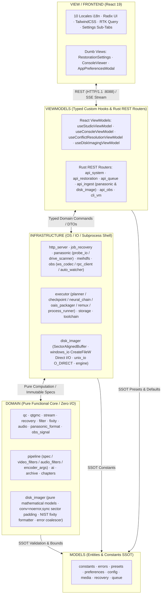
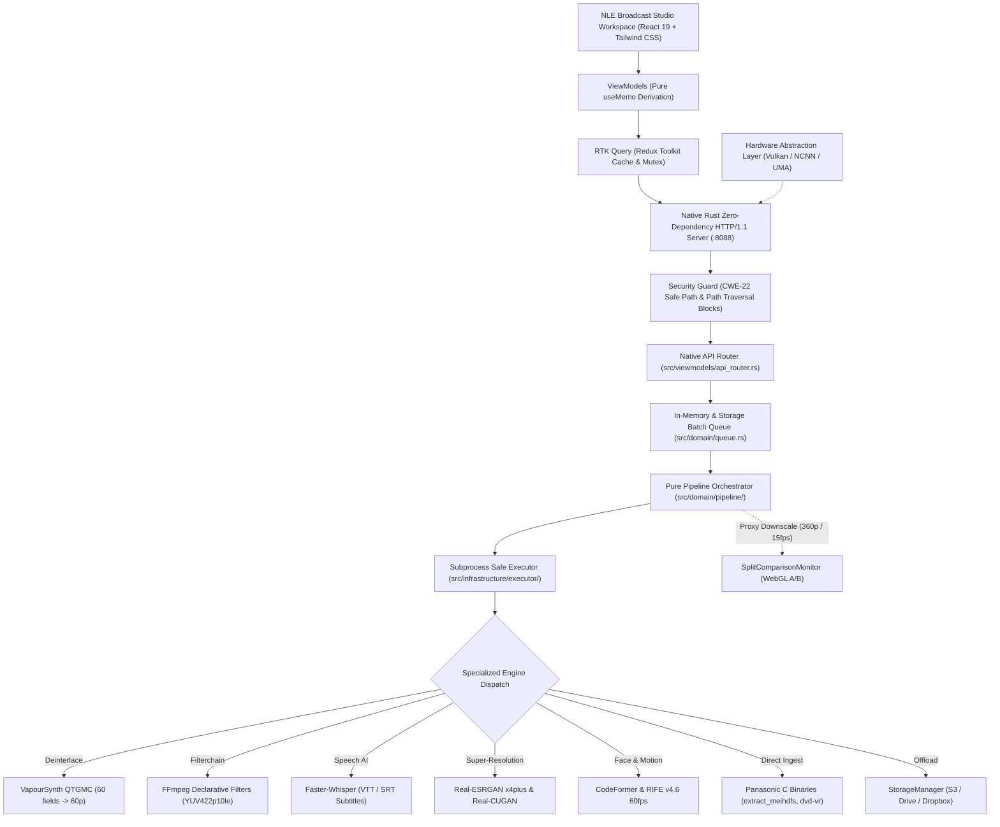
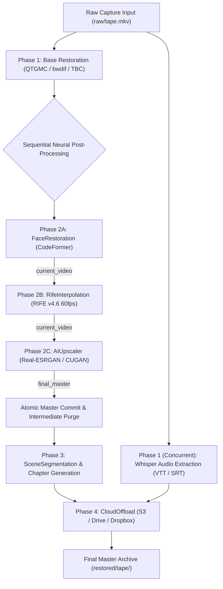
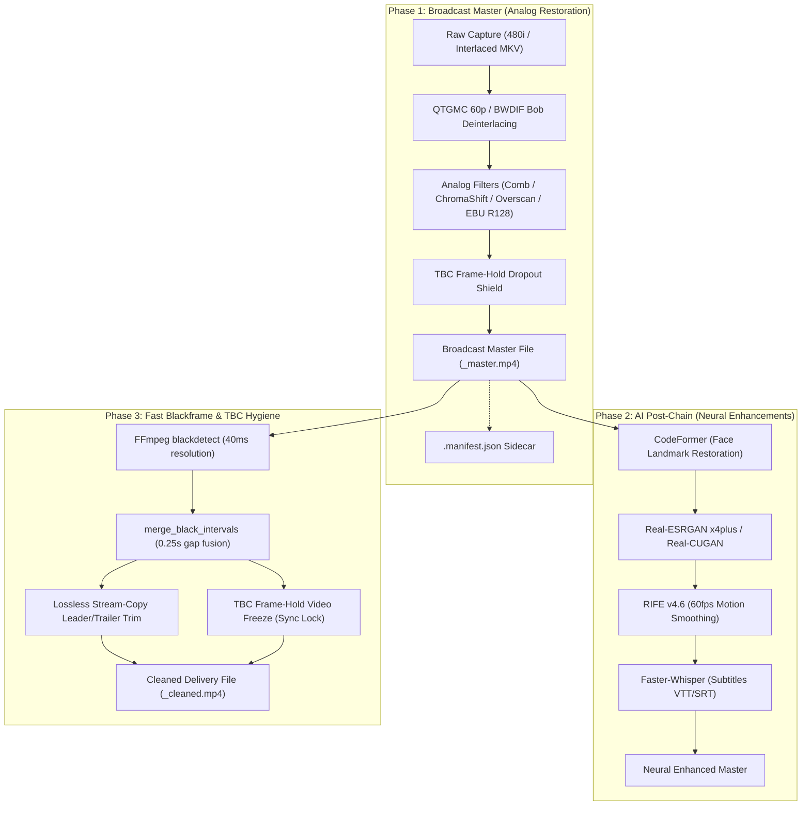

# 📐 System Architecture - VHS Studio Pro

This document provides a comprehensive technical overview of the architectural patterns, layered domain separation, data flows, modular decomposition, and functional programming paradigms implemented in **VHS Studio Pro**.

---

## 1. Core Architectural Principles

The architectural design of VHS Studio Pro satisfies stringent requirements for historical media preservation, operational robustness, and open-source maintainability:

1. **Separation of Concerns (SoC):** The presentation layer (View), state orchestrators and HTTP routers (ViewModel), and domain processing engines (Model) are strictly decoupled into independent, isolated, and unit-testable modules.
2. **Single Responsibility Principle (SRP):** Each subsystem fulfills a clearly delimited responsibility. The native HTTP/IPC server does not perform direct frame transformations; routers focus exclusively on input schema validation and task dispatching; FFmpeg filtergraphs are compiled via pure functional builders; and hardware diagnostics solely inspect host topology.
3. **Single Source of Truth (SSOT):** System-wide configuration parameters and restoration profiles reside in canonical authority files:
   - `Cargo.toml` (Native Rust core workspace, release profile with LTO and strip, dependencies)
   - `package.json` (UI dependencies, build scripts, and Vite/Oxlint tooling)
   - `vhs_advanced_config.toml` (Signal processing constants, thresholds, and restoration presets)
   - `src/models/constants.rs` (Canonical numerical limits, ports, buffer sizes, and network defaults)
   - `src/infrastructure/toolchain.rs` (Platform-agnostic binary resolution and fixity validation)
4. **Fail-Safe Process Execution:** Resource-intensive external engines (FFmpeg, VapourSynth, Faster-Whisper, Real-ESRGAN, CodeFormer) execute within isolated OS subprocesses managed by `infrastructure::executor`. Hardware memory faults or GPU driver resets cannot crash the native Rust HTTP daemon or disconnect the React client.
5. **Functional Core / Imperative Shell (FP Core):**
   - The algorithmic foundation is constructed using pure functions with zero side-effects (`resolve_deinterlace_filter`, `resolve_codec_video_args`, `build_master_ffmpeg_args`, `calculate_expected_frames`).
   - Shared mutable state has been eliminated. Structs are immutable by default, utilizing Rust's type system and ownership model.
   - Untyped dynamic constructs have been replaced with strict Rust ADTs (`enum`, `struct`), typed `Result<T, E>` monads, and strict TypeScript interfaces across frontend layers.
6. **Zero-Hardcode & Comprehensive i18n:** Zero literal strings in React components, 100% parity across all 10 locales (`pt-BR`, `en-US`, `es`, `fr`, `de`, `it`, `ja`, `ar`, `ru`, `zh-CN`), and zero magic numbers in code logic.

---

## 2. Diagnóstico e Arquitetura Consolidada (Clean MVVM 4-Tier & Decomposed Modules)

A migração de todo o código legado em Python para Rust nativo e a decomposição modular da **Fase 5.0** foram realizadas seguindo a arquitetura **MVVM de 4 camadas** e as diretrizes rigorosas do repositório (**FP Pureza, SoC, SRP, DRY, SSOT** e **ZERO-HARDCODE**):

---

## 3. Layered Application Structure & Process Orchestration

---

## 4. Modular Architecture Decomposition

The backend and frontend are decomposed into specialized, decoupled modules organized across four strict Clean Architecture / MVVM layers:

| Layer | Module Path | Core Responsibility |
| :--- | :--- | :--- |
| **Models** | [`src/models/`](file:///c:/Users/danie/Documents/vhs-capture-scripts-main/src/models/) | Immutable data models and single sources of truth (`config.rs`, `constants.rs`, `errors.rs`, `media.rs`, `preferences.rs`, `presets.rs`). |
| **Domain** | [`src/domain/`](file:///c:/Users/danie/Documents/vhs-capture-scripts-main/src/domain/) | Pure mathematical & algorithmic video restoration. **100% Zero-I/O Functional Core**: • `pipeline/` (`spec.rs`, `video_filters.rs`, `audio_filters.rs`, `encoder_args.rs`, `mod.rs`) • `panasonic_format.rs`, `obs_signal.rs` • `qtgmc.rs`, `qc.rs`, `whisper.rs`, `ai.rs`, `filter.rs`, `recovery.rs`, `audio.rs`, `stream.rs`, `chapters.rs`, `fixity.rs`, `archive.rs`. |
| **Infrastructure**| [`src/infrastructure/`](file:///c:/Users/danie/Documents/vhs-capture-scripts-main/src/infrastructure/) | OS processes, subprocess spawners, hardware discovery, Panasonic DVR I/O, storage adapters, HTTP daemon. **Imperative Shell**: • `executor/` (`planner.rs`, `checkpoint.rs`, `neural_chain.rs`, `oais_packager.rs`, `remux.rs`, `process_runner.rs`, `mod.rs`) • `panasonic/` (`probe_io.rs`, `drive_scanner.rs`, `mod.rs`) • `obs/` (`ws_codec.rs`, `rpc_client.rs`, `auto_watcher.rs`, `mod.rs`) • `storage.rs`, `hardware.rs`, `http_server.rs`, `toolchain.rs`, `preflight.rs`, `probe.rs`. |
| **ViewModels** | [`src/viewmodels/`](file:///c:/Users/danie/Documents/vhs-capture-scripts-main/src/viewmodels/) | API command dispatching, REST routes, and telemetry emitters: • `api_restoration/` (`comparison_frame.rs`, `whisper_service.rs`, `checkpoint_handlers.rs`, `qc_handlers.rs`, `lifecycle_handlers.rs`, `mod.rs`) • `cli_vm/` (`args_parser.rs`, `commands_archive_qc.rs`, `commands_restore.rs`, `commands_ingest_obs.rs`, `commands_system_queue.rs`, `mod.rs`) • `api_router.rs`, `capture_vm.rs`, `ingest_vm.rs`, `restoration_vm.rs`, `storage_vm.rs`, `system_vm.rs`, `ipc_commands.rs`. |
| **View (UI)** | [`ui/src/`](file:///c:/Users/danie/Documents/vhs-capture-scripts-main/ui/src/) | Pure presentation dumb components, Redux Toolkit Query client state, virtualized monitors, and i18n dictionaries: • `components/settings/` (`SettingsPrimitives.tsx`, `useSettingsSearchViewModel.ts`, `PresetsTab.tsx`, `VideoTab.tsx`, `AudioTab.tsx`, `FiltersTab.tsx`, `AdvancedTab.tsx`, `AiTab.tsx`, `StorageTab.tsx`) • `viewmodels/` (`useConsoleViewModel.ts`, `useConflictResolutionViewModel.ts`, `usePreferencesViewModel.ts`, `useStudioViewModel.ts`, `useRestorationViewModel.ts`, `useCaptureViewModel.ts`, `useSplitComparisonViewModel.ts`). |

---

## 5. Sequential Pipelined Chain Architecture (DAG)

The [`PipelineOrchestrator`](file:///c:/Users/danie/Documents/vhs-capture-scripts-main/src/domain/pipeline.rs) compiles video processing tasks into a Directed Acyclic Graph (DAG) implementing a **Sequential Pipelined Chain** for cumulative transformations:

### 4.1 Cumulative State Accumulator & Graceful Degradation
1. **Cumulative Chain:**
   $$\text{BaseOutput} \longrightarrow \text{FaceRestoration}(current) \longrightarrow \text{RIFE}(current) \longrightarrow \text{AIUpscaler}(current) \longrightarrow \text{Master}$$
2. **Graceful Degradation Error Boundaries:**
   Each neural stage executes inside an isolated failure domain. If an optional stage fails (e.g., CUDA out-of-memory or missing weights), the orchestrator logs a warning and **preserves the intact video from the preceding stage**, ensuring that base restorations are never compromised.
3. **Atomic Master Commit & Intermediate Artifact Purging:**
   Once the chain completes, the resulting file is committed atomically using filesystem renames. All intermediate temporary files recorded in the plan are safely unlinked, preventing disk space exhaustion.
4. **Deterministic Whisper Lifecycle:**
   Audio extraction to 16kHz mono PCM is temporary; uncompressed buffers are unconditionally purged on completion, failure, or cancellation.
5. **Master-Guarded Scene Detection:**
   Scene boundary extraction targets only the finalized, committed physical master file on disk, eliminating race conditions.

---

## 6. Reactive Frontend & Functional Purity

The frontend implementation in `ui/src/` strictly follows modern React 19 architecture:

1. **Elimination of Synchronization Loops (`useEffect`):**
   - State is derived purely via `useMemo`, integrating default configuration, remote RTK Query responses, and active user overrides without synchronization effects.
   - Initial modal display is evaluated via lazy state initialization (`useState(() => !localStorage.getItem(...))`), preventing cascading re-renders.
2. **Universal Structured Logging (`ui/src/lib/logger.ts`):**
   - Direct `console.log` and `console.error` calls are banned across UI components.
   - Centralized `StudioLogger` provides level filtering (`DEBUG`, `INFO`, `WARN`, `ERROR`), suppressed in production mode.
3. **Pure Utility Modules & Type Guards:**
   - [`ui/src/lib/errors.ts`](file:///c:/Users/danie/Documents/vhs-capture-scripts-main/ui/src/lib/errors.ts): Pure `getErrorMessage` extractor for safe message parsing from `unknown`.
   - [`ui/src/lib/formatters.ts`](file:///c:/Users/danie/Documents/vhs-capture-scripts-main/ui/src/lib/formatters.ts): Side-effect-free telemetry formatters (`formatBytes`, `formatBitrate`, `formatDuration`).
4. **Zero `any` Typing:**
   - All TypeScript modules are compiled under strict settings (`strict: true`), ensuring that untyped dynamic values or blind type assertions cannot reach production.

---

## 7. Code Integrity & Automated Verification

Codebase health is enforced across two complementary audit layers:

1. **Pre-Commit Quality Gate Suite (`scripts/lint.mts`):**
   - **JSCPD:** Clone detection enforcing zero code duplication (0% threshold / zero tolerance).
   - **Oxlint / ESLint:** Ultra-fast static analysis of the React/TypeScript ecosystem.
   - **TSC:** Strict type-checking compilation (`tsc -b`).
   - **Vitest:** React component, hook, and store unit test suite (34/34 files, 167/167 tests passed, 100%).
   - **Playwright:** End-to-End integration testing under headless Chromium.
   - **Cargo Check:** Fast compilation check of the entire native Rust core (0 errors).
   - **Cargo Clippy:** Strict idiomatic Rust linting (`clippy -- -D warnings`, 0 warnings).
   - **Cargo Test:** 264/264 native Rust unit tests covering all domain models, decomposed pipelines, and infrastructure (100% passing).
   - **i18n Parity:** Verification of key parity across all 10 supported translation dictionaries (100% key parity).
2. **Swarm Auditors (`scripts/swarm_auditors.mts`):**
   - 7 parallel auditors inspecting Architecture (SoC/SRP/MVVM), Dependencies, Security (zero hardcoded secrets), Code Quality & FP purity, Test Harness, UX/UI & A11y, and CI/CD pipelines.

---

## 8. Broadcast Telemetry & Footer StatusBar (NLE Standard)

Drawing from industry-standard non-linear editing suites (DaVinci Resolve, Adobe Premiere Pro, Cockos Reaper), monitoring is organized around a **permanent Footer StatusBar**:

1. **Visual Decoupling:**
   - The [`FooterStatusBar`](file:///c:/Users/danie/Documents/vhs-capture-scripts-main/ui/src/components/FooterStatusBar.tsx) permanently displays critical metrics, freeing the [`ConsoleViewer`](file:///c:/Users/danie/Documents/vhs-capture-scripts-main/ui/src/components/ConsoleViewer.tsx) to provide flexible, resizable diagnostic logs via `react-resizable-panels`.
2. **Deterministic Functional Telemetry Parser:**
   - Replaces arbitrary percentage jumps with accurate progression derivation based on real processed frame counts, explicit engine progress markers, and proportional stage weighting.
3. **Top 2.5px Render Ribbon:**
   - An unobtrusive 2.5px animated gradient ribbon (`sky-400` → `emerald-400` → `indigo-400`) delivers real-time progress along the top window border without consuming editing screen real estate.
4. **Real-Time Hardware Telemetry Drawer (`SystemTelemetryCard.tsx`):**
   - The Footer StatusBar includes an interactive hardware pill badge (`CPU X% • RAM Y%`) bound to RTK Query metrics.
   - Clicking the pill smoothly expands a retractable hardware telemetry drawer with live CSS sparkline load history (last 12 samples) and color-coded status thresholds.

---

## 9. Panasonic DVR Ingestion & Decoupled Toolchain

Panasonic standalone DVD/HDD recorders write recordings in specialized low-level formats:
1. **MEIHDFS-V2.0 and MEIHDFS-V1.0:** Matsushita Electric Industrial Host Disk File System with superblocks located in the partition table and initial media sectors.
2. **UDF / DVD-VR (`DVD_RTAV`):** Directory structures containing `VR_MANGR.IFO` and MPEG-2 Program Stream `.VRO` files.
3. **Continuous MPEG-2 Program Streams:** Data packets beginning with sync marker `0x000001BA` and video PES headers `0x000001E0`.

### Decoupled Toolchain Architecture
- **Binary Resolution:** Compiled utilities (`extract_meihdfs`, `dvd-vr`, `udf_dump`) are resolved hierarchically from `tools/panasonic_rec/` and system `PATH` via [`src/infrastructure/toolchain.rs`](file:///c:/Users/danie/Documents/vhs-capture-scripts-main/src/infrastructure/toolchain.rs).
- **Automated Cross-Compilation & Fixity:** [`scripts/build_panasonic_tools.mts`](file:///c:/Users/danie/Documents/vhs-capture-scripts-main/scripts/build_panasonic_tools.mts) compiles native C utilities across Windows (MinGW), Linux (GCC), and macOS (Clang), automatically validating precompiled binaries against SHA-256 fixity manifests in [`checksums.json`](file:///c:/Users/danie/Documents/vhs-capture-scripts-main/tools/panasonic_rec/checksums.json).
- **Zero-Carving Forensic Inode Preservation:** Unallocated sector carving was retired to eliminate fragmented GOP corruption and audio desync. The engine strictly parses MEIHDFS inodes and DVD-VR IFO tables via native C tools, falling back to direct intact `.VRO` container copying if title splitting is unavailable.

---

## 10. Zero-Hardcode Policy & Internationalization

As stipulated in [`AGENTS.md`](file:///c:/Users/danie/Documents/vhs-capture-scripts-main/AGENTS.md) and [`GEMINI.md`](file:///c:/Users/danie/Documents/vhs-capture-scripts-main/GEMINI.md), user-facing text is strictly separated from code logic:
1. **100% i18n:** Every React component must invoke `t('namespace.key')` from `react-i18next`. Static text literals in JSX, toast alerts, tooltips, or action buttons are prohibited.
2. **10 Native Locales:** Full parity across Portuguese (`pt-BR`), English (`en-US`), Spanish (`es`), French (`fr`), German (`de`), Italian (`it`), Japanese (`ja`), Arabic (`ar`, with mirrored RTL support), Russian (`ru`), and Simplified Chinese (`zh-CN`).
3. **SSOT for Numerical Constants:** Numerical limits, buffer sizes, and directory paths reside exclusively in [`src/models/constants.rs`](file:///c:/Users/danie/Documents/vhs-capture-scripts-main/src/models/constants.rs) and [`ui/src/lib/constants.ts`](file:///c:/Users/danie/Documents/vhs-capture-scripts-main/ui/src/lib/constants.ts).

---

## 11. Automated Quality Control & Analog Defect Diagnostics

The [`QualityControl`](file:///c:/Users/danie/Documents/vhs-capture-scripts-main/src/domain/qc.rs) subsystem performs automated diagnostics across archive captures:

1. **Unrecorded Leader Detection:** Automatically probes the head of the file for unrecorded tape leader ($\bar{Y} \le 18.0$) and identifies the exact sub-second timestamp where active recorded video begins.
2. **Interlace & Cadence Analysis (`idet`):** Evaluates temporal fields using multi-frame sampling to determine whether the stream is true interlaced (TFF / BFF) or progressive.
3. **Audio Channel Balance & Hum Probing:** Measures per-channel RMS decibels ($L$ vs $R$). If one channel is dead, recommends automatic mono-L duplication and 60Hz notch filtering.
4. **Temporal Outlier Dropout Detection:** Measures `TOUT` (Temporal Outliers), identifying magnetic oxide loss, white streaks, and tape dropouts across frames.
5. **Head Switching Noise Probing:** Detects the presence of helical head switching noise in the bottom 16 scanlines ($464–480\text{px}$).
6. **Automated Markdown QC Generation:** Calling `vhs-studio qc-report <INPUT>` produces structured forensic reports detailing every flaw, physical tape cause, and remediation filter.

---

## 12. Architectural Decision Records (ADRs) & Technology Stack Rationale

In accordance with broadcast and institutional archiving standards (**IASA-TC 04, FADGI 4-Star, CONARQ**), every technology selection is grounded in formal engineering trade-off evaluations:

### ADR-01: Native Rust Core (`vhs-studio-core`) replacing Python/FastAPI
- **Context:** The legacy implementation relied on Python 3.11 with FastAPI and PyInstaller packaging.
- **Decision:** Migrate the entire backend engine to native Rust (2021 edition).
- **Rationale:**
  1. **Deterministic Concurrency & Zero-Allocation Safety:** Rust guarantees memory safety without garbage collection pauses ($< 10\mu s$ jitter), ensuring continuous synchronization with OBS Studio WebSocket streams and high-throughput TCP sockets.
  2. **Elimination of Global Interpreter Lock (GIL):** Multi-threaded frame hashing (SHA-256 fixity) and telemetry computation achieve linear multicore scaling without process spawning overhead.
  3. **Binary Compactness & Security:** Standalone release binary is $< 20\text{ MB}$, eradicating PyInstaller unpacker heuristic false-positives in enterprise antivirus environments.
  4. **Strict Functional Programming (FP Pure):** Rust algebraic data types (`enum`, `struct`), pattern matching, and `Result<T, E>` monads enforce zero side-effects across all 14 domain modules.

### ADR-02: Tauri v2 + OS Native WebView2 / WebKit replacing Electron & PyWebView
- **Context:** The desktop GUI required cross-platform rendering (Windows, Linux, macOS) for NLE audio/video monitoring.
- **Decision:** Adopt Tauri v2 (`wry` engine) with OS-native WebView binding.
- **Rationale:**
  1. **Host Integration:** Utilizes Microsoft Edge WebView2 on Windows, WebKitGTK on Linux, and WKWebView on macOS.
  2. **Resource Footprint:** Base RAM consumption is $\approx 35\text{ MB}$ (versus $\ge 250\text{ MB}$ for Electron Chromium bundles).
  3. **High-Speed Type-Safe IPC:** `#[tauri::command]` exposes strongly typed entrypoints bridging frontend TypeScript callers directly into compiled Rust functions.

### ADR-03: Modern TypeScript Modules (`.mts`) for Toolchain & Quality Gates
- **Context:** Build scripts, linter orchestrators, and C cross-compilers required a unified maintenance language.
- **Decision:** Standardize on native TypeScript ESM (`.mts`) executed directly by Node.js 20+.
- **Rationale:**
  1. **Ecosystem Parity:** Eliminates multi-runtime tool fragmentation by aligning build scripts with the frontend React/TypeScript language standard.
  2. **Zero Transpilation Artifacts:** Node.js executes `.mts` modules with native ESM import syntax, producing clean build and lint reports in [`logs/build_report.md`](file:///c:/Users/danie/Documents/vhs-capture-scripts-main/logs/build_report.md).

### ADR-04: Subprocess Isolation for Multimodal Neural Networks
- **Context:** AI super-resolution (Real-ESRGAN), face reconstruction (CodeFormer), and frame interpolation (RIFE v4.6) utilize GPU VRAM and external drivers.
- **Decision:** Isolate all neural workloads within independent OS subprocesses supervised by `infrastructure::executor`.
- **Rationale:** GPU memory exhaustion (CUDA OOM) or driver timeouts are trapped as isolated process errors, guaranteeing that the core Rust server and active tape recording sessions are never terminated.

---

## 13. Multi-Pipeline Architecture, Media Lineage & Smart Pass Guardrail

The digitization and mastering workflow in VHS Studio Pro v0.1.0 is partitioned into three distinct phases to prevent multi-generational degradation:

### 13.1 Smart Pass Guardrail in Restoration Planner (`executor/planner.rs`)
When an operator queues or starts a restoration job on a media file:
1. The planner inspects both `probe_media_file` (`probe.is_interlaced`) and the companion `.manifest.json` (`manifest.is_progressive`).
2. If `is_already_progressive` is evaluated to `true`:
   - `deinterlacer` is automatically forced to `DeinterlaceFilter::None`.
   - `apply_chroma_fix` is forced to `false`.
   - `apply_comb_filter` is forced to `false`.
   - `apply_overscan_blanking` is forced to `false`.
   - `master_guard_bypassed` is flagged as `true` in telemetry and planned restoration.
3. This guarantees that progressive masters can undergo secondary neural passes (CodeFormer, Real-ESRGAN, RIFE, Faster-Whisper) or container remuxing without destructive re-deinterlacing, color misregistration, or redundant border cropping.

### 13.2 Media Lineage Manifest (`.manifest.json`)
Every rendered file maintains an immutable companion sidecar recording:
- `source_raw` and `source_raw_sha256`: Cryptographic provenance to original analog ingest.
- `completed_stages`: Set of applied operations (`stage_1_deinterlace_qtgmc`, `stage_1_chroma_shift`, `stage_3_blackframe_trim`, etc.).
- `available_stages`: Permissible next steps dynamically filtered based on progressive/master state.
- `history`: Chronological audit log with exact parameters and timestamps for every stage event.

---

## 14. Native Blackframe & TBC Frame-Hold Engine (`src/domain/blackframe.rs`)

Analog tape players often produce unrecorded black leaders, trailing run-outs, and tracking loss dropouts where video sync fails but analog audio continues uninterrupted.

### 14.1 Pure Algorithmic Pipeline
1. **Detection Pass (`build_blackdetect_cli_args`):**
   Runs non-destructive FFmpeg scan with parameters:
   `-vf blackdetect=d=0.040:pix_th=0.12:pic_th=0.96`
2. **Interval Parsing (`parse_blackdetect_stderr`):**
   Presents pure functional extraction of `[blackdetect]` stderr timestamps into `Vec<BlackInterval>`.
3. **Micro-Gap Fusion (`merge_black_intervals`):**
   Merges consecutive black intervals separated by brief analog noise burst gaps ($\le 0.25\text{s}$) into single coherent defect intervals.
4. **Forensic Region Classification (`classify_black_regions`):**
   - `leader`: Interval beginning within $0.5\text{s}$ of timecode $0.0$.
   - `trailer`: Interval ending within $0.5\text{s}$ of the stream's total duration.
   - `mid_gaps`: Interior dropouts caused by mechanical crease or tracking loss.

### 14.2 Synchronization Preservation Modes
- **Leader & Trailer Cutting:** Because both video and audio are silent/unrecorded, audio and video are trimmed synchronously (`-ss` and `-to` / `trim` + `atrim`), preserving sample-accurate lip sync.
- **Mid-Recording Dropouts (TBC Frame-Hold):** Deleting mid-tape black frames from the video stream without trimming continuous audio destroys lip sync. In `Freeze` mode, the engine freezes the last valid video frame across the dropout gap, holding video timing in strict lockstep with the continuous audio stream.

---

## 15. Modular Architecture & God-Module Decomposition (v0.1.0)

In version 0.1.0, VHS Studio Pro underwent a comprehensive architectural audit and refactoring to eliminate monolithic modules, isolate pure domain logic from side-effects, and achieve strict adherence to MVVM, Functional Programming (FP), SRP, SoC, DRY, and SSOT principles:

### 15.1 Pure Domain Extraction (FP Core)
1. **Hardware Assessment (`src/domain/hardware.rs`):**
   - Pure models: `GpuType`, `HardwareSpecs`, `HardwareAssessment`.
   - Pure function `assess_hardware(&HardwareSpecs) -> HardwareAssessment` evaluates capability tiers (Tier 1 to 4) and hardware-accelerated encoder eligibility with zero OS queries or side-effects.
2. **Storage Calculations (`src/domain/storage.rs`):**
   - Pure models: `StorageProviderKind`, `StorageConfig`, `StorageQuota`, `ChunkUploadPart`.
   - Pure calculation functions: `calculate_chunk_plan`, `validate_storage_config`, `verify_capacity`, and `format_destination_key`.
3. **Recovery Naming Rules (`src/domain/recovery.rs`):**
   - Pure functions `extract_raw_stem_from_restored_name` and `is_restored_filename` provide single-source-of-truth logic for raw-to-restored filename associations.
4. **Optimal Encoder Resolution (`src/domain/pipeline/encoder_args.rs`):**
   - Pure function `resolve_optimal_encoder_args` determines encoder arguments across NVENC, QSV, AMF, VideoToolbox, VAAPI, and software fallbacks.
5. **Frame Calculation Bounds (`src/domain/pipeline/mod.rs`):**
   - Pure mathematical calculations: `expected_output_frames`, `is_output_truncated`, and `bounded_tail`.

### 15.2 Rust Infrastructure & ViewModel Modularization
1. **Quality Control Subsystem (`src/domain/qc/`):**
   - Monolithic 671-line module decomposed into `models.rs` (data structures & broadcast thresholds), `metrics.rs` (pure planar mathematical calculations & frame delta MSE), `reporting.rs` (forensic Markdown report generators), and clean facade in `mod.rs`.
2. **Native Toolchain Engine (`src/infrastructure/toolchain/`):**
   - Monolithic 710-line engine decomposed into `types.rs` (process flags & manifests), `resolver.rs` (executable path candidate search & environment resolution), `process.rs` (silent & compute command creation), `probes.rs` (QTGMC, OBS, and FFmpeg encoder viability probes), and `integrity.rs` (SHA-256 fixity manifest validation).
3. **Desktop App Lifecycle Isolation (`src/infrastructure/desktop_runtime.rs`):**
   - Isolates Tauri desktop window creation, local HTTP/SSE background daemon startup, and graceful shutdown into `run_desktop_app`.
4. **Job Recovery Subsystem (`src/infrastructure/job_recovery/`):**
   - `scanner.rs`: File-system traversal, recursive directory discovery, and target resolution.
   - `repair.rs`: FFmpeg partial stream finalizing (`finalize_partial_video`) and atomic orphan job discard.
   - `conflict_resolver.rs`: Checks existing restoration runs and pair resolutions.
5. **Panasonic Ingest Decomposition (`src/viewmodels/api_ingest/`):**
   - `panasonic_routes.rs`: Handles disk inspections, title trees, and MEIHDFS/DVD-VR extraction.
   - `disk_image_routes.rs`: Direct physical block imaging endpoints (`drives`, `start`, `cancel`).
6. **IPC Commands Modularization (`src/viewmodels/ipc/`):**
   - Split 52 Tauri IPC commands into 4 focused submodules: `system_ipc.rs`, `restoration_ipc.rs`, `ingest_ipc.rs`, and `storage_ipc.rs`.
   - `src/viewmodels/ipc_commands.rs` serves as a clean, backward-compatible facade.

### 15.3 TypeScript Bridge, Store, and Component Decomposition
1. **Modular IPC Bridge (`ui/src/api/bridge/`):**
   - `systemBridge.ts`, `restorationBridge.ts`, `ingestBridge.ts`, `storageBridge.ts`, coordinated via `index.ts`.
   - Circular dependency between `studioApi.ts` and `tauriBridge.ts` eliminated via `ui/src/api/runtimeEnv.ts`.
2. **Redux Store Modularization (`ui/src/store/studio/`):**
   - Monolithic slice partitioned into `types.ts`, `logReducers.ts`, `layoutReducers.ts`, and `restorationReducers.ts`.
3. **Studio Primary ViewModel Sub-Hooks (`ui/src/viewmodels/studio/`):**
   - Monolithic 526-line `useStudioViewModel.ts` decomposed into focused sub-hooks: `useStudioLogStream.ts` (SSE streaming & batching), `useStudioToolInstallers.ts` (OBS & QTGMC installation workflows), `useStudioCapture.ts` (live capture triggers), and `useStudioRestoration.ts` (restoration lifecycle coordination).
4. **Decoupled View Components:**
   - **Scopes (`ui/src/components/scopes/`):** Modularized 706-line `BroadcastScopes.tsx` into `ScopeHeader.tsx`, `ScopeViews.tsx`, `ScopeAudioMeters.tsx`, and Canvas 2D rasterizers in `scopeCanvasRenderers.ts`.
   - **Preferences Modal (`ui/src/components/preferences/`):** Modularized 565-line `AppPreferencesModal.tsx` into `DirectoryField.tsx`, `PreferenceSwitchRow.tsx`, `DirectoriesTabContent.tsx`, `PerformanceTabContent.tsx`, `ConsoleTabContent.tsx`, `HardwareTabContent.tsx`, and `InterfaceTabContent.tsx`.
   - **A/B Split Monitor (`ui/src/components/comparison/`):** Modularized 545-line `SplitComparisonMonitor.tsx` into `ComparisonPane.tsx`, `SplitComparisonHeader.tsx`, and `SplitTransportBar.tsx`.
   - **Panasonic Ingest (`ui/src/components/panasonic/`):** Title trees extracted to `PanasonicRecordingTreePanel.tsx`; block imaging extracted to `PanasonicDiskImagingPanel.tsx`; drive header extracted to `DetectedDrivesHeader.tsx`.
   - **Tape Library (`ui/src/components/library/`):** Individual tape cards extracted to `TapeItemCard.tsx`; empty states extracted to `EmptyTapeListState.tsx`.
   - **Preferences Constants (`ui/src/lib/constants.ts`):** Configuration option arrays extracted from inline JSX into immutable constant singletons.

