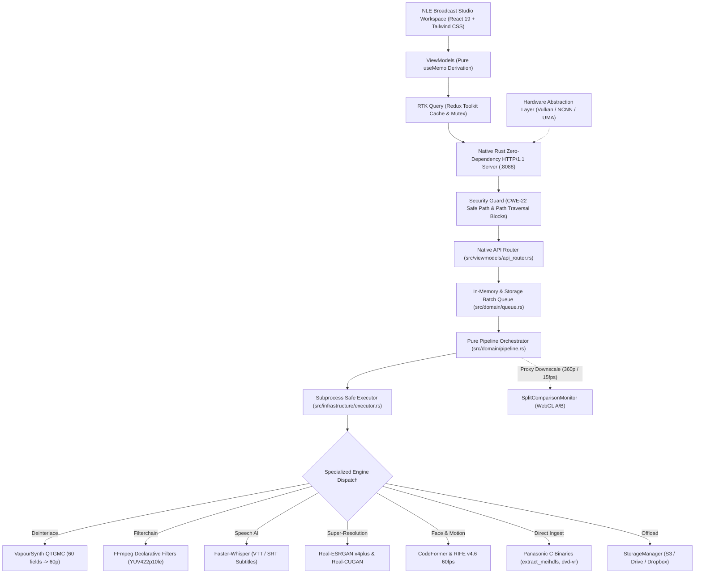
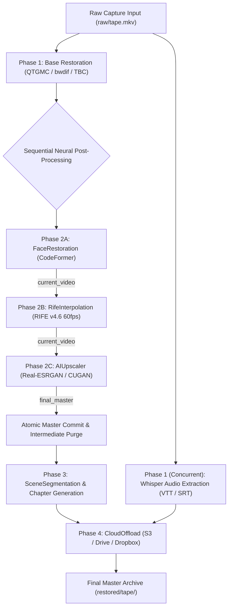

# 📐 System Architecture - VHS Studio Pro

This document provides a comprehensive technical overview of the architectural patterns, layered domain separation, data flows, modular decomposition, and functional programming paradigms implemented in **VHS Studio Pro**.

---

## 1. Core Architectural Principles

The architectural design of VHS Studio Pro satisfies stringent requirements for historical media preservation, operational robustness, and open-source maintainability:

1. **Separation of Concerns (SoC):** The presentation layer (View), state orchestrators and HTTP routers (ViewModel), and domain processing engines (Model) are strictly decoupled into independent, isolated, and unit-testable modules.
2. **Single Responsibility Principle (SRP):** Each subsystem fulfills a clearly delimited responsibility. The native HTTP/IPC server does not perform direct frame transformations; routers focus exclusively on input schema validation and task dispatching; FFmpeg filtergraphs are compiled via pure functional builders; and hardware diagnostics solely inspect host topology.
3. **Single Source of Truth (SSOT):** System-wide configuration parameters and restoration profiles reside in canonical authority files:
   - `Cargo.toml` (Native Rust core workspace, release profile with LTO and strip, dependencies)
   - `package.json` (UI dependencies, build scripts, and Vite/Oxlint tooling)
   - `vhs_advanced_config.toml` (Signal processing constants, thresholds, and restoration presets)
   - `src/models/constants.rs` (Canonical numerical limits, ports, buffer sizes, and network defaults)
   - `src/infrastructure/toolchain.rs` (Platform-agnostic binary resolution and fixity validation)
4. **Fail-Safe Process Execution:** Resource-intensive external engines (FFmpeg, VapourSynth, Faster-Whisper, Real-ESRGAN, CodeFormer) execute within isolated OS subprocesses managed by `infrastructure::executor`. Hardware memory faults or GPU driver resets cannot crash the native Rust HTTP daemon or disconnect the React client.
5. **Functional Core / Imperative Shell (FP Core):**
   - The algorithmic foundation is constructed using pure functions with zero side-effects (`resolve_deinterlace_filter`, `resolve_codec_video_args`, `build_master_ffmpeg_args`, `calculate_expected_frames`).
   - Shared mutable state has been eliminated. Structs are immutable by default, utilizing Rust's type system and ownership model.
   - Untyped dynamic constructs have been replaced with strict Rust ADTs (`enum`, `struct`), typed `Result<T, E>` monads, and strict TypeScript interfaces across frontend layers.

---

## 2. Layered Application Structure (Strict MVVM)

---

## 3. Modular Architecture Decomposition

The backend is decomposed into specialized, decoupled modules organized across four strict Clean Architecture / MVVM layers:

| Layer | Module Path | Core Responsibility |
| :--- | :--- | :--- |
| **Models** | [`src/models/`](file:///c:/Users/danie/Documents/vhs-capture-scripts-main/src/models/) | Immutable data models (`config.rs`, `constants.rs`, `media.rs`, `preferences.rs`, `presets.rs`). |
| **Domain** | [`src/domain/`](file:///c:/Users/danie/Documents/vhs-capture-scripts-main/src/domain/) | Pure mathematical & algorithmic video restoration (`pipeline.rs`, `qtgmc.rs`, `qc.rs`, `whisper.rs`, `ai.rs`, `filter.rs`, `recovery.rs`, `audio.rs`, `tbc.rs`, `queue.rs`, `stream.rs`, `chapters.rs`, `fixity.rs`, `archive.rs`). Free of I/O side effects. |
| **Infrastructure**| [`src/infrastructure/`](file:///c:/Users/danie/Documents/vhs-capture-scripts-main/src/infrastructure/) | OS processes, subprocess spawners, hardware discovery, Panasonic DVR I/O, storage adapters, HTTP daemon (`executor.rs`, `hardware.rs`, `http_server.rs`, `i18n_validator.rs`, `lock.rs`, `meihdfs.rs`, `oauth.rs`, `obs.rs`, `package.rs`, `panasonic.rs`, `preflight.rs`, `probe.rs`, `runner.rs`, `storage.rs`, `thumbnail.rs`, `toolchain.rs`). |
| **ViewModels** | [`src/viewmodels/`](file:///c:/Users/danie/Documents/vhs-capture-scripts-main/src/viewmodels/) | API command dispatching and telemetry emitters (`api_router.rs`, `capture_vm.rs`, `cli_vm.rs`, `ingest_vm.rs`, `restoration_vm.rs`, `storage_vm.rs`, `system_vm.rs`). |
| **View (UI)** | [`ui/src/`](file:///c:/Users/danie/Documents/vhs-capture-scripts-main/ui/src/) | Pure presentation components, Redux Toolkit Query client state, virtualized monitors, and i18n dictionaries. |

---

## 4. Sequential Pipelined Chain Architecture (DAG)

The [`PipelineOrchestrator`](file:///c:/Users/danie/Documents/vhs-capture-scripts-main/src/domain/pipeline.rs) compiles video processing tasks into a Directed Acyclic Graph (DAG) implementing a **Sequential Pipelined Chain** for cumulative transformations:

### 4.1 Cumulative State Accumulator & Graceful Degradation
1. **Cumulative Chain:**
   $$\text{BaseOutput} \longrightarrow \text{FaceRestoration}(current) \longrightarrow \text{RIFE}(current) \longrightarrow \text{AIUpscaler}(current) \longrightarrow \text{Master}$$
2. **Graceful Degradation Error Boundaries:**
   Each neural stage executes inside an isolated failure domain. If an optional stage fails (e.g., CUDA out-of-memory or missing weights), the orchestrator logs a warning and **preserves the intact video from the preceding stage**, ensuring that base restorations are never compromised.
3. **Atomic Master Commit & Intermediate Artifact Purging:**
   Once the chain completes, the resulting file is committed atomically using filesystem renames. All intermediate temporary files recorded in the plan are safely unlinked, preventing disk space exhaustion.
4. **Deterministic Whisper Lifecycle:**
   Audio extraction to 16kHz mono PCM is temporary; uncompressed buffers are unconditionally purged on completion, failure, or cancellation.
5. **Master-Guarded Scene Detection:**
   Scene boundary extraction targets only the finalized, committed physical master file on disk, eliminating race conditions.

---

## 5. Reactive Frontend & Functional Purity

The frontend implementation in `ui/src/` strictly follows modern React 19 architecture:

1. **Elimination of Synchronization Loops (`useEffect`):**
   - State is derived purely via `useMemo`, integrating default configuration, remote RTK Query responses, and active user overrides without synchronization effects.
   - Initial modal display is evaluated via lazy state initialization (`useState(() => !localStorage.getItem(...))`), preventing cascading re-renders.
2. **Universal Structured Logging (`ui/src/lib/logger.ts`):**
   - Direct `console.log` and `console.error` calls are banned across UI components.
   - Centralized `StudioLogger` provides level filtering (`DEBUG`, `INFO`, `WARN`, `ERROR`), suppressed in production mode.
3. **Pure Utility Modules & Type Guards:**
   - [`ui/src/lib/errors.ts`](file:///c:/Users/danie/Documents/vhs-capture-scripts-main/ui/src/lib/errors.ts): Pure `getErrorMessage` extractor for safe message parsing from `unknown`.
   - [`ui/src/lib/formatters.ts`](file:///c:/Users/danie/Documents/vhs-capture-scripts-main/ui/src/lib/formatters.ts): Side-effect-free telemetry formatters (`formatBytes`, `formatBitrate`, `formatDuration`).
4. **Zero `any` Typing:**
   - All TypeScript modules are compiled under strict settings (`strict: true`), ensuring that untyped dynamic values or blind type assertions cannot reach production.

---

## 6. Code Integrity & Automated Verification

Codebase health is enforced across two complementary audit layers:

1. **Pre-Commit Quality Gate Suite (`scripts/lint.mts`):**
   - **JSCPD:** Clone detection enforcing zero code duplication (0% threshold / zero tolerance).
   - **Oxlint / ESLint:** Ultra-fast static analysis of the React/TypeScript ecosystem.
   - **TSC:** Strict type-checking compilation (`tsc -b`).
   - **Vitest:** React component, hook, and store unit test suite.
   - **Playwright:** End-to-End integration testing under headless Chromium.
   - **Cargo Check:** Fast compilation check of the entire native Rust core.
   - **Cargo Clippy:** Strict idiomatic Rust linting (`clippy -- -D warnings`).
   - **Cargo Test:** 150/150 native Rust unit tests covering all domain models and infrastructure.
   - **i18n Parity:** Verification of key parity across all 10 supported translation dictionaries.
2. **Swarm Auditors (`scripts/swarm_auditors.mts`):**
   - 7 parallel auditors inspecting Architecture (SoC/SRP/MVVM), Dependencies, Security (zero hardcoded secrets), Code Quality & FP purity, Test Harness, UX/UI & A11y, and CI/CD pipelines.

---

## 7. Broadcast Telemetry & Footer StatusBar (NLE Standard)

Drawing from industry-standard non-linear editing suites (DaVinci Resolve, Adobe Premiere Pro, Cockos Reaper), monitoring is organized around a **permanent Footer StatusBar**:

1. **Visual Decoupling:**
   - The [`FooterStatusBar`](file:///c:/Users/danie/Documents/vhs-capture-scripts-main/ui/src/components/FooterStatusBar.tsx) permanently displays critical metrics, freeing the [`ConsoleViewer`](file:///c:/Users/danie/Documents/vhs-capture-scripts-main/ui/src/components/ConsoleViewer.tsx) to provide flexible, resizable diagnostic logs via `react-resizable-panels`.
2. **Deterministic Functional Telemetry Parser:**
   - Replaces arbitrary percentage jumps with accurate progression derivation based on real processed frame counts, explicit engine progress markers, and proportional stage weighting.
3. **Top 2.5px Render Ribbon:**
   - An unobtrusive 2.5px animated gradient ribbon (`sky-400` → `emerald-400` → `indigo-400`) delivers real-time progress along the top window border without consuming editing screen real estate.
4. **Real-Time Hardware Telemetry Drawer (`SystemTelemetryCard.tsx`):**
   - The Footer StatusBar includes an interactive hardware pill badge (`CPU X% • RAM Y%`) bound to RTK Query metrics.
   - Clicking the pill smoothly expands a retractable hardware telemetry drawer with live CSS sparkline load history (last 12 samples) and color-coded status thresholds.

---

## 8. Panasonic DVR Ingestion & Decoupled Toolchain

Panasonic standalone DVD/HDD recorders write recordings in specialized low-level formats:
1. **MEIHDFS-V2.0 and MEIHDFS-V1.0:** Matsushita Electric Industrial Host Disk File System with superblocks located in the partition table and initial media sectors.
2. **UDF / DVD-VR (`DVD_RTAV`):** Directory structures containing `VR_MANGR.IFO` and MPEG-2 Program Stream `.VRO` files.
3. **Continuous MPEG-2 Program Streams:** Data packets beginning with sync marker `0x000001BA` and video PES headers `0x000001E0`.

### Decoupled Toolchain Architecture
- **Binary Resolution:** Compiled utilities (`extract_meihdfs`, `dvd-vr`, `udf_dump`) are resolved hierarchically from `tools/panasonic_rec/` and system `PATH` via [`src/infrastructure/toolchain.rs`](file:///c:/Users/danie/Documents/vhs-capture-scripts-main/src/infrastructure/toolchain.rs).
- **Automated Cross-Compilation & Fixity:** [`scripts/build_panasonic_tools.mts`](file:///c:/Users/danie/Documents/vhs-capture-scripts-main/scripts/build_panasonic_tools.mts) compiles native C utilities across Windows (MinGW), Linux (GCC), and macOS (Clang), automatically validating precompiled binaries against SHA-256 fixity manifests in [`checksums.json`](file:///c:/Users/danie/Documents/vhs-capture-scripts-main/tools/panasonic_rec/checksums.json).
- **Zero-Carving Forensic Inode Preservation:** Unallocated sector carving was retired to eliminate fragmented GOP corruption and audio desync. The engine strictly parses MEIHDFS inodes and DVD-VR IFO tables via native C tools, falling back to direct intact `.VRO` container copying if title splitting is unavailable.

---

## 9. Zero-Hardcode Policy & Internationalization

As stipulated in [`AGENTS.md`](file:///c:/Users/danie/Documents/vhs-capture-scripts-main/AGENTS.md) and [`GEMINI.md`](file:///c:/Users/danie/Documents/vhs-capture-scripts-main/GEMINI.md), user-facing text is strictly separated from code logic:
1. **100% i18n:** Every React component must invoke `t('namespace.key')` from `react-i18next`. Static text literals in JSX, toast alerts, tooltips, or action buttons are prohibited.
2. **10 Native Locales:** Full parity across Portuguese (`pt-BR`), English (`en-US`), Spanish (`es`), French (`fr`), German (`de`), Italian (`it`), Japanese (`ja`), Arabic (`ar`, with mirrored RTL support), Russian (`ru`), and Simplified Chinese (`zh-CN`).
3. **SSOT for Numerical Constants:** Numerical limits, buffer sizes, and directory paths reside exclusively in [`src/models/constants.rs`](file:///c:/Users/danie/Documents/vhs-capture-scripts-main/src/models/constants.rs) and [`ui/src/lib/constants.ts`](file:///c:/Users/danie/Documents/vhs-capture-scripts-main/ui/src/lib/constants.ts).

---

## 10. Automated Quality Control & Analog Defect Diagnostics

The [`QualityControl`](file:///c:/Users/danie/Documents/vhs-capture-scripts-main/src/domain/qc.rs) subsystem performs automated diagnostics across archive captures:

1. **Unrecorded Leader Detection:** Automatically probes the head of the file for unrecorded tape leader ($\bar{Y} \le 18.0$) and identifies the exact sub-second timestamp where active recorded video begins.
2. **Interlace & Cadence Analysis (`idet`):** Evaluates temporal fields using multi-frame sampling to determine whether the stream is true interlaced (TFF / BFF) or progressive.
3. **Audio Channel Balance & Hum Probing:** Measures per-channel RMS decibels ($L$ vs $R$). If one channel is dead, recommends automatic mono-L duplication and 60Hz notch filtering.
4. **Temporal Outlier Dropout Detection:** Measures `TOUT` (Temporal Outliers), identifying magnetic oxide loss, white streaks, and tape dropouts across frames.
5. **Head Switching Noise Probing:** Detects the presence of helical head switching noise in the bottom 16 scanlines ($464–480\text{px}$).
6. **Automated Markdown QC Generation:** Calling `vhs-studio qc-report <INPUT>` produces structured forensic reports detailing every flaw, physical tape cause, and remediation filter.

---

## 11. Architectural Decision Records (ADRs) & Technology Stack Rationale

In accordance with broadcast and institutional archiving standards (**IASA-TC 04, FADGI 4-Star, CONARQ**), every technology selection is grounded in formal engineering trade-off evaluations:

### ADR-01: Native Rust Core (`vhs-studio-core`) replacing Python/FastAPI
- **Context:** The legacy implementation relied on Python 3.11 with FastAPI and PyInstaller packaging.
- **Decision:** Migrate the entire backend engine to native Rust (2021 edition).
- **Rationale:**
  1. **Deterministic Concurrency & Zero-Allocation Safety:** Rust guarantees memory safety without garbage collection pauses ($< 10\mu s$ jitter), ensuring continuous synchronization with OBS Studio WebSocket streams and high-throughput TCP sockets.
  2. **Elimination of Global Interpreter Lock (GIL):** Multi-threaded frame hashing (SHA-256 fixity) and telemetry computation achieve linear multicore scaling without process spawning overhead.
  3. **Binary Compactness & Security:** Standalone release binary is $< 20\text{ MB}$, eradicating PyInstaller unpacker heuristic false-positives in enterprise antivirus environments.
  4. **Strict Functional Programming (FP Pure):** Rust algebraic data types (`enum`, `struct`), pattern matching, and `Result<T, E>` monads enforce zero side-effects across all 14 domain modules.

### ADR-02: Tauri v2 + OS Native WebView2 / WebKit replacing Electron & PyWebView
- **Context:** The desktop GUI required cross-platform rendering (Windows, Linux, macOS) for NLE audio/video monitoring.
- **Decision:** Adopt Tauri v2 (`wry` engine) with OS-native WebView binding.
- **Rationale:**
  1. **Host Integration:** Utilizes Microsoft Edge WebView2 on Windows, WebKitGTK on Linux, and WKWebView on macOS.
  2. **Resource Footprint:** Base RAM consumption is $\approx 35\text{ MB}$ (versus $\ge 250\text{ MB}$ for Electron Chromium bundles).
  3. **High-Speed Type-Safe IPC:** `#[tauri::command]` exposes strongly typed entrypoints bridging frontend TypeScript callers directly into compiled Rust functions.

### ADR-03: Modern TypeScript Modules (`.mts`) for Toolchain & Quality Gates
- **Context:** Build scripts, linter orchestrators, and C cross-compilers required a unified maintenance language.
- **Decision:** Standardize on native TypeScript ESM (`.mts`) executed directly by Node.js 20+.
- **Rationale:**
  1. **Ecosystem Parity:** Eliminates multi-runtime tool fragmentation by aligning build scripts with the frontend React/TypeScript language standard.
  2. **Zero Transpilation Artifacts:** Node.js executes `.mts` modules with native ESM import syntax, producing clean build and lint reports in [`logs/build_report.md`](file:///c:/Users/danie/Documents/vhs-capture-scripts-main/logs/build_report.md).

### ADR-04: Subprocess Isolation for Multimodal Neural Networks
- **Context:** AI super-resolution (Real-ESRGAN), face reconstruction (CodeFormer), and frame interpolation (RIFE v4.6) utilize GPU VRAM and external drivers.
- **Decision:** Isolate all neural workloads within independent OS subprocesses supervised by `infrastructure::executor`.
- **Rationale:** GPU memory exhaustion (CUDA OOM) or driver timeouts are trapped as isolated process errors, guaranteeing that the core Rust server and active tape recording sessions are never terminated.
