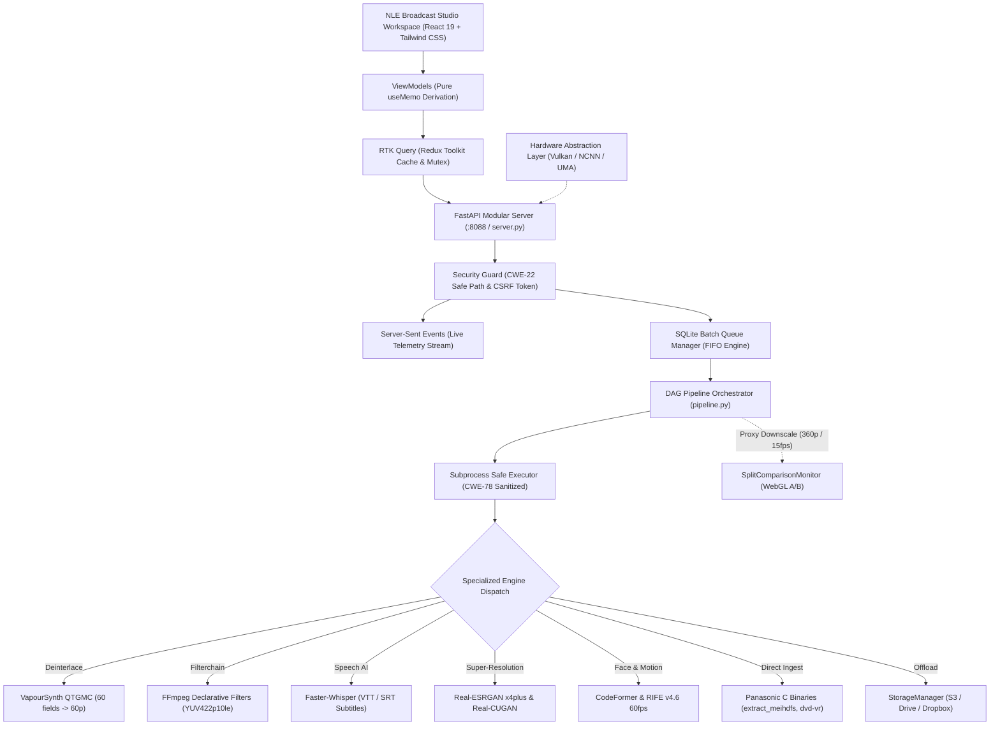
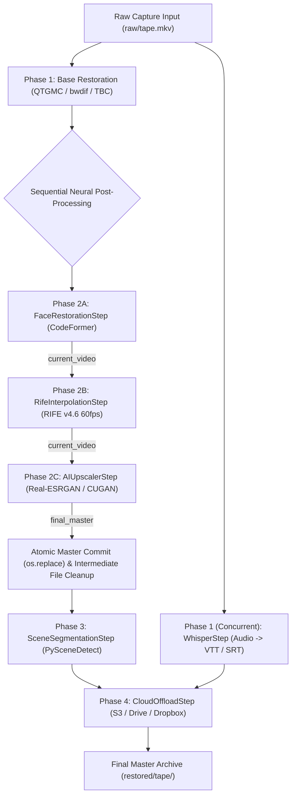

# 📐 System Architecture - VHS Studio Pro

This document provides a comprehensive technical overview of the architectural patterns, layered domain separation, data flows, modular decomposition, and functional programming paradigms implemented in **VHS Studio Pro**.

---

## 1. Core Architectural Principles

The architectural design of VHS Studio Pro satisfies stringent requirements for historical media preservation, operational robustness, and open-source maintainability:

1. **Separation of Concerns (SoC):** The presentation layer (View), state orchestrators and HTTP routers (ViewModel), and domain processing engines (Model) are strictly decoupled into independent, isolated, and unit-testable modules.
2. **Single Responsibility Principle (SRP):** Each subsystem fulfills a clearly delimited responsibility. The API server does not perform direct frame transformations; routers focus exclusively on input schema validation and task dispatching; FFmpeg filtergraphs are compiled via pure functional builders; and hardware diagnostics solely inspect host topology.
3. **Single Source of Truth (SSOT):** System-wide configuration parameters and restoration profiles reside in canonical authority files:
   - `pyproject.toml` (PEP 621 Python packaging, linters, and runtime dependencies)
   - `package.json` (UI dependencies, build scripts, and Vite/Oxlint tooling)
   - `vhs_advanced_config.toml` (Signal processing constants, thresholds, and restoration presets)
   - `src/vhs_studio/core/constants.py` (Canonical numerical limits and network defaults)
   - `src/vhs_studio/core/paths.py` (Filesystem root resolution and platform binary path resolution)
4. **Fail-Safe Process Execution:** Resource-intensive external engines (FFmpeg, VapourSynth, Faster-Whisper, Real-ESRGAN, CodeFormer) execute within isolated OS subprocesses managed by `ProcessManager`. Hardware memory faults or GPU driver resets cannot crash the FastAPI HTTP daemon or disconnect the React client.
5. **Functional Core / Imperative Shell (FP Core):**
   - The algorithmic foundation is constructed using pure functions and closures with zero side-effects (`make_step_runner`, `make_origin_verifier`, `make_obs_client_provider`, `resolve_deinterlace_filter`, `resolve_codec_video_args`).
   - Shared mutable globals (`global`) have been eliminated from the codebase.
   - Untyped dynamic constructs (`Any` / `any`) have been replaced with strict `TypedDict` schemas, Pydantic models, and TypeScript interfaces across both backend and frontend layers.

---

## 2. Layered Application Structure (Strict MVVM)

---

## 3. Modular API Decomposition (`routers/`)

The monolithic 528-line `server.py` implementation was decomposed into specialized, decoupled modules within `src/vhs_studio/api/routers/`:

| Module | Core Responsibility | Primary Endpoints |
| :--- | :--- | :--- |
| **[`system.py`](file:///c:/Users/danie/Documents/vhs-capture-scripts-main/src/vhs_studio/api/routers/system.py)** | System diagnostics, hardware capability profiling, real-time CPU/RAM telemetry, and logs | `GET /api/token` `GET /api/status` `GET /api/hardware` `GET /api/system/metrics` `GET /api/logs` `GET /api/logs/stream` (SSE) |
| **[`queue.py`](file:///c:/Users/danie/Documents/vhs-capture-scripts-main/src/vhs_studio/api/routers/queue.py)** | Transactional management of the persistent SQLite FIFO batch queue | `GET /api/queue` `POST /api/queue/enqueue` `POST /api/queue/cancel/{id}` `POST /api/queue/start` `POST /api/queue/stop` |
| **[`obs.py`](file:///c:/Users/danie/Documents/vhs-capture-scripts-main/src/vhs_studio/api/routers/obs.py)** | OBS Studio integration and telemetry streaming via WebSocket v5 | `GET /api/obs/stats` `POST /api/obs/start` `POST /api/obs/stop` `POST /api/obs/virtualcam` |
| **[`restoration.py`](file:///c:/Users/danie/Documents/vhs-capture-scripts-main/src/vhs_studio/api/routers/restoration.py)** | Restoration job execution, non-destructive pause/resume, and A/B frame comparison | `POST /api/run` `POST /api/action` `GET /api/monitor/comparison-frame` `GET /api/restoration/incomplete` |
| **[`ingest.py`](file:///c:/Users/danie/Documents/vhs-capture-scripts-main/src/vhs_studio/api/routers/ingest.py)** | Panasonic DVR MEIHDFS/DVD-VR hotplug detection, title tree mapping, and selective extraction | `GET /api/ingest/panasonic/disks` `GET /api/ingest/panasonic/inspect` `GET /api/ingest/panasonic/tree` `POST /api/ingest/panasonic/extract-titles` |
| **[`media.py`](file:///c:/Users/danie/Documents/vhs-capture-scripts-main/src/vhs_studio/api/routers/media.py)** | Real-time extraction and HTTP caching of video frame thumbnails | `GET /api/media/thumbnail` |
| **[`storage.py`](file:///c:/Users/danie/Documents/vhs-capture-scripts-main/src/vhs_studio/api/routers/storage.py)** | Configuration, validation, and connectivity tests for local and cloud storage providers | `GET /api/storage/config` `POST /api/storage/config` |
| **[`security.py`](file:///c:/Users/danie/Documents/vhs-capture-scripts-main/src/vhs_studio/api/routers/security.py)** | Path traversal defenses (CWE-22), origin/host validation, and CSRF token verification | `is_safe_media_path` `make_origin_verifier` `SESSION_TOKEN` |
| **[`schemas.py`](file:///c:/Users/danie/Documents/vhs-capture-scripts-main/src/vhs_studio/api/routers/schemas.py)** | Strict Pydantic models for request payload validation | `StorageConfigPayload` `QueueEnqueuePayload` `ActionPayload` `PanasonicExtractTitlesPayload` |
| **[`server.py`](file:///c:/Users/danie/Documents/vhs-capture-scripts-main/src/vhs_studio/api/server.py)** | Lightweight application factory (84 lines) orchestrating router registration | `create_app()` `run_server()` |

---

## 4. Sequential Pipelined Chain Architecture (DAG)

The [`PipelineOrchestrator`](file:///c:/Users/danie/Documents/vhs-capture-scripts-main/src/vhs_studio/pipeline.py#L40) manages video processing tasks via a Directed Acyclic Graph (DAG) implementing a **Sequential Pipelined Chain** for cumulative neural transformations:

### 4.1 Cumulative State Accumulator & Graceful Degradation
Unlike parallel fan-out pipelines where stages discard previous outputs, VHS Studio Pro passes an accumulator variable `current_video`:

1. **Cumulative Chain:**
   $$\text{BaseOutput} \longrightarrow \text{FaceRestoration}(current) \longrightarrow \text{RIFE}(current) \longrightarrow \text{AIUpscaler}(current) \longrightarrow \text{Master}$$
2. **Graceful Degradation Error Boundaries:**
   Each neural stage executes inside an isolated `try ... except` block. If an optional stage fails (e.g., CUDA out-of-memory or missing weights) or returns `None`/`False`, the orchestrator logs a warning and **preserves the intact video from the preceding stage**, ensuring that base restorations are never compromised.
3. **Atomic Master Commit & Intermediate Artifact Purging:**
   Once the chain completes, the resulting file is committed atomically to `self.output_path` using `os.replace`. All intermediate temporary files recorded in `intermediate_files` are safely unlinked, preventing disk space exhaustion.
4. **Deterministic Whisper Lifecycle:**
   In [`WhisperEngine.transcribe_and_generate_vtt`](file:///c:/Users/danie/Documents/vhs-capture-scripts-main/src/vhs_studio/ai/whisper_engine.py), audio extraction is wrapped in a strict `try ... finally` block. The temporary uncompressed PCM `_temp.wav` is unconditionally purged on completion, failure, or cancellation.
5. **Master-Guarded Scene Detection:**
   [`_task_scenedetect_and_split`](file:///c:/Users/danie/Documents/vhs-capture-scripts-main/src/vhs_studio/pipeline.py#L207) targets only the finalized, committed physical master file on disk, eliminating null reference crashes.

---

## 5. Reactive Frontend & Functional Purity

The frontend implementation in `ui/src/` strictly follows modern React 19 architecture:

1. **Elimination of Synchronization Loops (`useEffect`):**
   - In [`useStorageViewModel.ts`](file:///c:/Users/danie/Documents/vhs-capture-scripts-main/ui/src/viewmodels/useStorageViewModel.ts), state is derived purely via `useMemo`, integrating default configuration, remote RTK Query responses, and active user overrides without synchronization effects.
   - In [`PrivacyModal.tsx`](file:///c:/Users/danie/Documents/vhs-capture-scripts-main/ui/src/components/PrivacyModal.tsx), initial modal display is evaluated via lazy state initialization (`useState(() => !localStorage.getItem(...))`), preventing cascading re-renders.
2. **Pure Utility Modules & Type Guards:**
   - [`ui/src/lib/errors.ts`](file:///c:/Users/danie/Documents/vhs-capture-scripts-main/ui/src/lib/errors.ts): Pure [`getErrorMessage`](file:///c:/Users/danie/Documents/vhs-capture-scripts-main/ui/src/lib/errors.ts#L5-L19) extractor for safe message parsing from `unknown`.
   - [`ui/src/lib/formatters.ts`](file:///c:/Users/danie/Documents/vhs-capture-scripts-main/ui/src/lib/formatters.ts): Side-effect-free telemetry formatters (`formatBytes`, `formatBitrate`, `formatDuration`).
3. **Zero `any` Typing:**
   - All TypeScript modules are compiled under strict settings (`strict: true`), ensuring that untyped dynamic values or blind type assertions cannot reach production.

---

## 6. Code Integrity & Automated Verification

Codebase health is enforced across two complementary audit layers:

1. **Pre-Commit Quality Gate Suite (`scripts/lint.py`):**
   - **Oxlint / ESLint:** Ultra-fast static analysis of the React/TypeScript ecosystem.
   - **Mypy:** Strict Python type validation (`--ignore-missing-imports`).
   - **Flake8:** PEP 8 compliance, 120-column line limit, and code smell detection.
   - **JSCPD:** Clone detection preventing code duplication exceeding a 5% threshold.
   - **Vitest:** React component, hook, and store unit test suite.
   - **Playwright:** End-to-End integration testing under headless Chromium.
   - **TSC:** Type-checking compilation (`tsc --noEmit`).
   - **Pytest:** Comprehensive backend unit and integration test suite.
   - **i18n Parity:** Verification of key parity across all 10 supported translation dictionaries.
2. **Swarm Auditors (`scripts/swarm_auditors.py`):**
   - 7 parallel auditors inspecting Architecture (SoC/SRP), CI/CD, Test Harness, UX/UI & A11y, Security (Bandit AST), Dependency health, and Functional Programming compliance (zero globals, zero `Any`, zero technical debt markers).

---

## 7. Broadcast Telemetry & Footer StatusBar (NLE Standard)

Drawing from industry-standard non-linear editing suites (DaVinci Resolve, Adobe Premiere Pro, Cockos Reaper), monitoring is organized around a **permanent Footer StatusBar**:

1. **Visual Decoupling and Elimination of Vertical Space Contention:**
   - Previously, telemetry competed for vertical space with the log drawer.
   - The [`FooterStatusBar`](file:///c:/Users/danie/Documents/vhs-capture-scripts-main/ui/src/components/FooterStatusBar.tsx) permanently displays critical metrics, freeing the [`ConsoleViewer`](file:///c:/Users/danie/Documents/vhs-capture-scripts-main/ui/src/components/ConsoleViewer.tsx) to provide flexible, resizable diagnostic logs via `react-resizable-panels`.
2. **Deterministic Functional Telemetry Parser (`createTelemetryParser`):**
   - Implemented as a factory closure with zero loose mutable variables.
   - Replaces arbitrary percentage jumps with accurate progression derivation:
     - Real processed frame counts (`currentFrames / totalFrames * 100`).
     - Explicit engine progress markers (`[PROGRESS: X%]`).
     - Proportional stage weighting (`(stage - 1) / totalStages * 100`).
3. **Dynamic Stage Resolution (`getPresetStages`):**
   - Breadcrumb stages adapt dynamically to the selected preset (Broadcast Standard, Ultrafast, TBC Frame-Hold, AI Master, or Custom).
4. **Top 2.5px Render Ribbon:**
   - An unobtrusive 2.5px animated gradient ribbon (`sky-400` → `emerald-400` → `indigo-400`) delivers real-time progress along the top window border without consuming editing screen real estate.
5. **Real-Time Hardware Telemetry Drawer (`SystemTelemetryCard.tsx`):**
   - The Footer StatusBar includes an interactive hardware pill badge (`CPU X% • RAM Y%`) bound to [`useGetSystemMetricsQuery`](file:///c:/Users/danie/Documents/vhs-capture-scripts-main/ui/src/api/studioRtkApi.ts).
   - Clicking the pill smoothly expands a retractable hardware telemetry drawer with live CSS sparkline load history (tracking the last 12 samples) and color-coded status thresholds (Emerald `< 70%`, Amber `70–89%`, Rose `≥ 90%`).
   - The same telemetry card is embedded in compact mode within the Hardware & AI tab of [`RestorationSettings.tsx`](file:///c:/Users/danie/Documents/vhs-capture-scripts-main/ui/src/components/RestorationSettings.tsx), providing operators with immediate resource visibility before triggering intensive neural jobs.

---

## 8. Windows Subprocess Robustness (OEM CP850 / UTF-8)

On Windows installations utilizing non-English regional configurations (such as Portuguese OEM CP850 or Brazilian CP1252), native command-line utilities (`tasklist`, `netstat`, system probes) emit text encoded in the machine's OEM code page. Accented characters (such as `Ç`) produce byte `0x80`.

When standard Python subprocesses read pipe streams using strict UTF-8 decoding, the internal `_readerthread` of `subprocess.py` crashes with:
`UnicodeDecodeError: 'utf-8' codec can't decode byte 0x80 in position 7: invalid start byte`.

To eliminate this vulnerability across all Windows environments:
- Every invocation of `subprocess.run` and `subprocess.Popen` in text mode explicitly specifies `errors="replace"`.
- Calls in [`system.py`](file:///c:/Users/danie/Documents/vhs-capture-scripts-main/src/vhs_studio/api/routers/system.py), [`watcher.py`](file:///c:/Users/danie/Documents/vhs-capture-scripts-main/src/vhs_studio/cli/watcher.py), [`setup_qtgmc.py`](file:///c:/Users/danie/Documents/vhs-capture-scripts-main/src/vhs_studio/cli/setup_qtgmc.py), [`process_manager.py`](file:///c:/Users/danie/Documents/vhs-capture-scripts-main/src/vhs_studio/api/process_manager.py), and [`hardware.py`](file:///c:/Users/danie/Documents/vhs-capture-scripts-main/src/vhs_studio/core/hardware.py) ensure continuous stream reading, substituting unreadable characters with standard replacement symbols without terminating reading threads.

---

## 9. Cryptographic Build Verification (SHA-256)

The native Desktop launcher ([`desktop.py`](file:///c:/Users/danie/Documents/vhs-capture-scripts-main/src/vhs_studio/cli/desktop.py)) computes a composite SHA-256 digest across `ui/src/` and `ui/package.json`:

- If the computed hash matches `.build_hash` in `ui/dist/`, Vite recompilation is bypassed, launching the native WebView2 window in under 1 second.
- If modifications are detected, the launcher requests operator confirmation before building bundles or running Node.js scripts, preventing unverified automated execution.

---

## 10. Panasonic DVR Ingestion & Decoupled Toolchain

Panasonic standalone DVD/HDD recorders write recordings in specialized low-level formats:
1. **MEIHDFS-V2.0 and MEIHDFS-V1.0:** Matsushita Electric Industrial Host Disk File System with superblocks located in the partition table and initial media sectors.
2. **UDF / DVD-VR (`DVD_RTAV`):** Directory structures containing `VR_MANGR.IFO` and MPEG-2 Program Stream `.VRO` files.
3. **Continuous MPEG-2 Program Streams:** Data packets beginning with sync marker `0x000001BA` and video PES headers `0x000001E0`.

### Decoupled Toolchain Architecture
Rather than intermingling legacy C code within the core Python codebase:
- **Binary Resolution:** Compiled utilities (`extract_meihdfs`, `dvd-vr`, `vro2split`, `udf_dump`) are resolved hierarchically from the portable directory `tools/panasonic_rec/` and the system `PATH` via [`paths.py`](file:///c:/Users/danie/Documents/vhs-capture-scripts-main/src/vhs_studio/core/paths.py) and [`Toolchain`](file:///c:/Users/danie/Documents/vhs-capture-scripts-main/src/vhs_studio/core/toolchain.py).
- **Automated Cross-Compilation:** [`scripts/build_panasonic_tools.py`](file:///c:/Users/danie/Documents/vhs-capture-scripts-main/scripts/build_panasonic_tools.py) builds native binaries across Windows (MinGW/MSVC), Linux (GCC), and macOS (Clang) both during local development and within CI/CD runners.
- **Continuous Hotplug (3s Polling):** Automated polling detects physical USB-SATA bridge attachments (**JMicron JMS567**, **ASMedia**, **Realtek**) and raw block devices, expanding the card and loading session trees without manual intervention.
- **Zero-Carving Forensic Inode Preservation:** Unallocated sector carving was retired to eliminate fragmented GOP corruption and audio desync. The engine strictly parses MEIHDFS inodes and DVD-VR IFO tables via native C tools, falling back to direct intact `.VRO` container copying if title splitting is unavailable.

---

## 11. Zero-Hardcode Policy & Internationalization

As stipulated in [`AGENTS.md`](file:///c:/Users/danie/Documents/vhs-capture-scripts-main/AGENTS.md) and [`GEMINI.md`](file:///c:/Users/danie/Documents/vhs-capture-scripts-main/GEMINI.md), user-facing text is strictly separated from the code logic:
1. **100% i18n:** Every React component must invoke `t('namespace.key')` from `react-i18next`. Static text literals in JSX, toast alerts, tooltips, or action buttons are prohibited.
2. **10 Native Locales:** Full parity across Portuguese (`pt-BR`), English (`en-US`), Spanish (`es`), French (`fr`), German (`de`), Italian (`it`), Japanese (`ja`), Arabic (`ar`, with mirrored RTL support), Russian (`ru`), and Simplified Chinese (`zh-CN`).
3. **SSOT for Numerical Constants:** Numerical limits, buffer sizes, and directory paths must reside exclusively in `constants.py` and `paths.py`.

---

## 12. Real-Time A/B Split-Screen Monitor & Stream Proxy

To inspect the effects of deinterlacing, chroma alignment, and denoising in real time without competing with production rendering:
- **Low-Latency Proxy Downscaler (360p / 15fps):** `GET /api/monitor/comparison-frame` processes a dual-frame slice (Raw Interlaced vs Processed Progressive) utilizing under 2% CPU overhead and responding in less than 50ms.
- **Dynamic 4:3 Aspect Ratio Preservation:** [`_resolve_preview_scale_filter`](file:///c:/Users/danie/Documents/vhs-capture-scripts-main/src/vhs_studio/api/routers/restoration.py#L360) detects SD analog captures (480i/576i) versus modern 16:9 HD material. For standard 4:3 VHS sources, it injects pillarbox padding (`scale=w=480:h=360:force_original_aspect_ratio=decrease,pad=640:360:(ow-iw)/2:(oh-ih)/2`), guaranteeing 1:1 pixel geometry without horizontal stretching.
- **Robust Process Tree Cleanup (`_kill_stream_process_tree`):** When preview modals are closed or operators scrub the timeline, client HTTP connections disconnect abruptly. To prevent orphaned `ffmpeg.exe` processes from saturating CPU cores on Windows, [`_kill_stream_process_tree`](file:///c:/Users/danie/Documents/vhs-capture-scripts-main/src/vhs_studio/api/routers/restoration.py#L366) closes `proc.stdout`, traverses `psutil.Process(proc.pid).children(recursive=True)`, and forcefully terminates all child worker processes before terminating the parent.
- **Interactive Split Slider:** [`SplitComparisonMonitor.tsx`](file:///c:/Users/danie/Documents/vhs-capture-scripts-main/ui/src/components/SplitComparisonMonitor.tsx) provides smooth dragging, keyboard navigation (`ArrowLeft` / `ArrowRight`), and temporal position seeking.
- **Zero Overhead Toggle:** Operators can disable the monitor at any moment to allocate 100% of workstation cycles to the primary restoration pipeline.

---

## 13. Integrated GPU (UMA) Optimization & Hardware Profiling

On computers utilizing integrated graphics (Intel UHD 770 / Iris Xe / AMD Radeon):
1. **Unified Memory Architecture (UMA):** RAM and VRAM share physical memory channels. Video decoding stays in multi-threaded software within host memory, eliminating PCIe bus transfer bottlenecks.
2. **Vulkan NCNN (Real-ESRGAN):** Tensor computations execute directly via Vulkan (`-g 0`). NCNN allocates buffers in shared memory accessible by the iGPU's Execution Units.
3. **Hardware Acceleration Silicon:** Fixed-function encoders (`h264_qsv`, `hevc_qsv`, AMD AMF) encode output frames without burdening CPU cores required by VapourSynth QTGMC.
4. **Whisper Concurrency Calibration:** CPU worker threads are limited to 4–8 to prevent thermal throttling during long jobs.

---

## 14. Non-Blocking Cross-Platform Terminal Workstation (TUI)

The terminal interface ([`tui.py`](file:///c:/Users/danie/Documents/vhs-capture-scripts-main/src/vhs_studio/cli/tui.py)) achieves feature parity across platforms:
- **POSIX (Linux / macOS):** Uses `termios`, `tty.setcbreak()`, and `select.select()` for asynchronous, non-blocking capture of ANSI escape sequences (`\x1b[A`, `\x1b[B`, etc.).
- **Windows:** Uses the Windows CRT runtime (`msvcrt.kbhit()` and `msvcrt.getch()`).
- Operators navigate menus using directional arrows (`↑`, `↓`, `←`, `→`), confirm with `ENTER`, toggle options with `SPACE`, and pause/abort with `Q` or `ESC` identically across Bash, Zsh, CMD, and PowerShell.

---

## 15. Incomplete Job Recovery Subsystem

To prevent data loss caused by unexpected power disruptions or reboots:
1. **Instant Pause & Resume:**
   - `pause_process`: Suspends execution via OS signals (`SIGSTOP` on POSIX / `SuspendThread` on Windows), freeing CPU/GPU resources immediately.
   - `resume_process`: Re-engages execution (`SIGCONT` / `ResumeThread`).
2. **Clean Abort:** `abort_process` halts worker trees, clears stale file locks, and removes corrupt temporary buffers.
3. **Job Recovery Subsystem ([`job_recovery.py`](file:///c:/Users/danie/Documents/vhs-capture-scripts-main/src/vhs_studio/video/job_recovery.py)):**
   - Automatically detects residual temporary files (`.tmp.mp4`, `.tmp.mkv`).
   - Offers three deterministic API actions (`/api/restoration/incomplete/action`):
     - **`resume`**: Resumes from the last processed frame index.
     - **`finalize`**: Repairs the video container via FFmpeg stream-copy (`-c copy`) and moves the `moov` atom to the file head (`-movflags +faststart`), rendering partial videos immediately playable.
     - **`discard`**: Safely cleans up temporary remnants.

---

## 16. Automated Quality Control & Analog Defect Diagnostics

To bridge the gap between low-level signal processing and historical preservation records, the [`QualityControl`](file:///c:/Users/danie/Documents/vhs-capture-scripts-main/src/vhs_studio/capture/qc.py) subsystem performs deep automated diagnostics across archive captures:

1. **Unrecorded Leader Detection (`find_first_video_frame`):**
   - Automatically probes the head of the file for unrecorded tape leader ($\bar{Y} \le 18.0$) and identifies the exact sub-second timestamp where active recorded video begins.
2. **Interlace & Cadence Analysis (`idet`):**
   - Evaluates 300 temporal fields using multi-frame sampling to determine whether the stream is true interlaced (TFF / BFF) or progressive, preventing double-deinterlacing degradation.
3. **Audio Channel Balance & Hum Probing (`astats`):**
   - Measures per-channel RMS decibels ($L$ vs $R$). If one channel is dead (e.g. $R \le -55\text{ dB}$ while $L \ge -45\text{ dB}$), it recommends automatic mono-L duplication and 60Hz notch filtering.
4. **Temporal Outlier Dropout Detection (`signalstats`):**
   - Measures `TOUT` (Temporal Outliers), identifying magnetic oxide loss, white streaks, and tape dropouts across frames.
5. **Head Switching Noise Probing:**
   - Detects the presence of helical head switching noise in the bottom 16 scanlines ($464–480\text{px}$).
6. **Automated Dual-Report Generation:**
   - Calling `QualityControl.run_qc(filepath)` produces:
     - `<file>_qc_report.json`: Machine-readable structured diagnostics for automated tooling.
     - `<file>_defect_report.md`: Human-readable forensic report mapping every observed flaw, timecode range, physical tape cause, and the exact digital filter to correct it.

