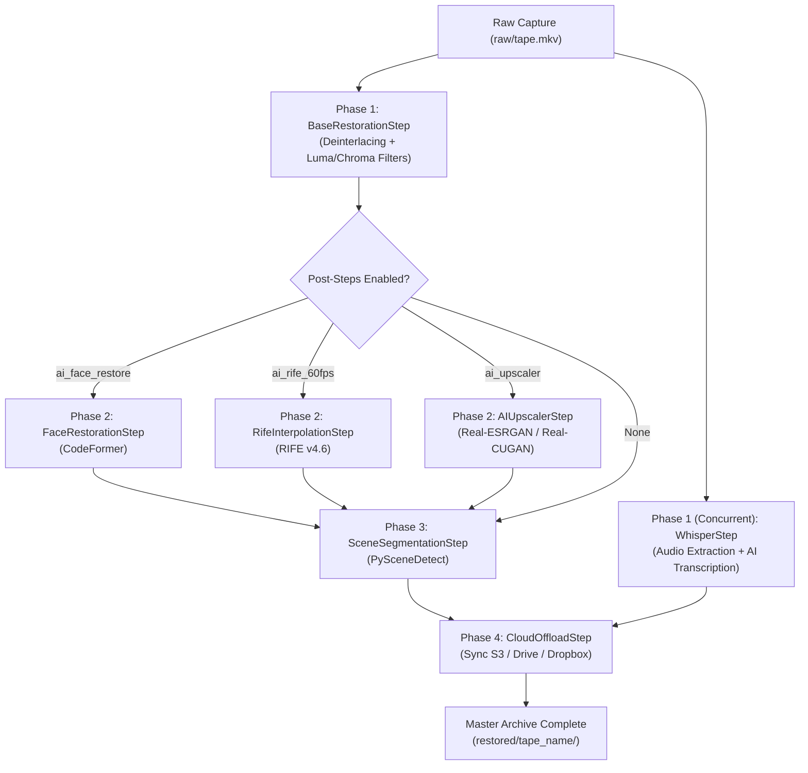

# 🎞️ Restoration Pipeline Technical Guide - VHS Studio Pro

<div align="justify">

This guide provides technical specifications for the Directed Acyclic Graph (DAG) orchestration engine, processing pipelines, motion-compensated deinterlacing algorithms, analog noise reduction filterchains, and multimodal neural network models implemented in **VHS Studio Pro**.

</div>

---

## 1. The Physics and Characteristics of Analog Video Signals

<div align="justify">

Restoring legacy magnetic tape media (VHS, S-VHS, Betamax, Video8, Hi8) requires domain-specific signal processing fundamentally distinct from typical digital format transcoding:

1. **Interlacing (Temporal Fields):** The analog video signal consists of 59.94 (NTSC) or 50 (PAL) temporal *fields* per second. Alternating odd and even horizontal scanlines were captured at distinct moments in time. Improper merging creates severe combing artifacts (*interlace combing*).
2. **Chroma Subcarrier Bandwidth Limitation (~0.6 MHz):** Color difference subcarrier bandwidth in VHS is restricted to roughly 0.6 MHz (compared to > 3.0 MHz for luminance). This results in prominent color bleeding, horizontal chroma delay, and high-frequency noise spikes (*rainbowing* / chroma noise).
3. **Mechanical Time Base Jitter (TBC Errors):** Mechanical imperfections in capstan motors, tape tension arms, and head drum rotation induce horizontal displacement (*line jitter* and *flagging* at the top of the raster).
4. **Cumulative Audio/Video Desynchronization:** Signal dropouts without a hardware Time Base Corrector cause capture devices to drop corrupted video frames while recording continuous audio, producing acute cumulative drift over a 2-hour capture.

</div>

---

## 2. Parallel DAG Orchestration (`pipeline.py`)

<div align="justify">

VHS Studio Pro replaces monolithic sequential scripts with a modular, concurrent **Directed Acyclic Graph (DAG)** execution pipeline:

</div>



### 2.1 Fault Isolation via Functional Closures (`make_step_runner`)
<div align="justify">

Each optional neural post-processing phase is encapsulated inside a functional error-boundary closure:

```python
def make_step_runner(step_name: str, fn: Callable[[], Optional[str]]) -> Callable[[], Optional[str]]:
    def run() -> Optional[str]:
        try:
            res = fn()
            log.info(f"[{step_name.upper()}] Step completed successfully.")
            return res
        except Exception as exc:
            log.error(f"[{step_name.upper()} ERROR] Step failed: {exc}")
            return None
    return run
```

If an optional model (such as CodeFormer) encounters an unhandled runtime error (e.g., missing network weights or GPU out-of-memory), the pipeline logs the diagnostic error cleanly and preserves the master video produced during the base restoration phase without corrupting the pipeline.

</div>

---

## 3. Motion-Compensated Deinterlacing Benchmark

<div align="justify">

The deinterlacing engine synthesizes interlaced fields into full-rate progressive frames (59.94p / 50p):

</div>

| Algorithm | Engine | Output Rate | Computational Complexity | Reconstruction & Motion Stability | Primary Use Case |
| :--- | :--- | :--- | :--- | :--- | :--- |
| **QTGMC (Slower/Slow)** | VapourSynth | 59.94p / 50p | Very High (Multi-core CPU) | **Reference Grade.** Motion-vector temporal smoothing, edge refinement, and complete elimination of bob shimmer. | **Archival Masters & Final Deliverables** |
| **QTGMC (Fast)** | VapourSynth | 59.94p / 50p | High | **Very Good.** Lower motion vector density while preserving temporal stability. | **Batch Archives / Mid-Range Workstations** |
| **bwdif** | Native FFmpeg | 59.94p / 50p | Moderate (1x–3x real-time) | **Good.** Direction-adaptive bob deinterlacing. Substantially superior to basic yadif. | **High-Speed Ingestion & Safe Fallback** |
| **znedi3 / nnedi3** | VapourSynth / FFmpeg | 59.94p / 50p | Moderate-High | **Specialized.** Neural directional interpolation for sharp edge recreation. | **High-Bandwidth S-VHS / TBC Captures** |

---

## 4. Analog Noise Reduction & Declarative Filterchain (`filter_builder.py`)

<div align="justify">

The FFmpeg filtergraph is generated through **pure, declarative functional composition** without global mutable state:

1. **Luma and Chroma Planar Separation:**
   - Spatial filters operate independently on chrominance planes (`U` and `V`) to suppress color bleeding and cross-color rainbowing without softening the high-frequency luminance (`Y`) plane.
2. **HQDN3D (High-Quality 3D Denoise):**
   - Evaluates spatio-temporal noise variance across frames, eliminating high-frequency analog snow without creating trailing ghosts (*ghosting*).
3. **Dropout Cleaner:**
   - Detects horizontal white dropout streaks caused by magnetic oxide loss and replaces damaged raster segments via temporal interpolation from adjacent fields.
4. **Overscan Blanking (12px Mask):**
   - Cleanly blanks out the bottom 12 scanlines containing helical head-switching noise, preventing flashing bars on modern digital displays.

</div>

---

## 5. Multimodal Artificial Intelligence Suite

<div align="justify">

### 5.1 Blind Face Restoration (CodeFormer)
- Restores facial landmarks, iris definition, and lip contours degraded by VHS low horizontal resolution (~240 lines).
- Configurable fidelity weighting (`ai_face_fidelity` between `0.1` and `0.9`) strikes the optimal balance between natural historical likeness and clarity enhancement, preventing waxy synthetic skin textures.

### 5.2 Optical Flow Motion Interpolation (RIFE v4.6)
- Employs deep bidirectional optical flow networks to generate smooth transitions in 25p/30p material targeted for 60fps presentation without telecine judder.

### 5.3 Deep Convolutional Super-Resolution (Real-ESRGAN / Real-CUGAN)
- **Real-ESRGAN x4plus:** Focuses on sharp edge delineation, crisp typography, and textural definition.
- **Real-CUGAN (`models-se`):** Optimized for retaining organic film grain and subtle analog gradations.

### 5.4 Acoustic Speech Recognition & Subtitling (Faster-Whisper)
- Audio extraction normalized to broadcast LUFS standards.
- 100% offline neural transcription with automatic language identification.
- Produces synchronized `.vtt` (Web Video Text Tracks) for browser rendering and `.srt` (SubRip) for professional NLE suites.

</div>

---

## 6. Canonical Studio Presets

<div align="justify">

Restoration configurations are mapped to four core profiles in [`vhs_advanced_config.toml`](file:///c:/Users/danie/Documents/vhs-capture-scripts-main/vhs_advanced_config.toml):

</div>

| Preset | ID | Filter & Codec Configuration | Operational Objective |
| :--- | :--- | :--- | :--- |
| **Broadcast Standard** | `gold` | QTGMC Slow (60p) + ProRes 422 / H.264 CRF 18 + TBC Passthrough | Reference archival master for heritage collections and precious family tapes. |
| **Hardware Ultrafast** | `speed` | BWDIF (60p) + NVENC / AMF / QSV CRF 22 + Lanczos 1080p | High-throughput batch transfer (300+ fps processing rate). |
| **TBC Frame-Hold** | `tbc_hold` | Frame-Hold Dropout Shield + ZNEDI3 + Mono-L JVC | Salvaging damaged, creased, or severely out-of-sync tapes. |
| **AI Master** | `ai_master` | QTGMC + Real-ESRGAN x4plus + CodeFormer + Faster-Whisper | Comprehensive 4K digital restoration for modern large displays. |

---

## 7. Real-Time Process Control (Pause, Resume & Safe Abort)

<div align="justify">

Long restoration runs (tapes spanning 2 to 6 hours) require deterministic operational control:

- **Non-Destructive Pause (`POST /api/action {"action": "pause_process"}`):**
  - Sends operating system thread suspension signals (`SuspendThread` on Windows, `SIGSTOP` on POSIX).
  - CPU and GPU utilization drops to 0% immediately, allowing the host system to perform critical tasks without aborting or desynchronizing video buffers.
- **Instant Resume (`POST /api/action {"action": "resume_process"}`):**
  - Resumes the process tree (`ResumeThread` / `SIGCONT`), continuing from the exact frame where it paused.
- **Safe Abort (`POST /api/action {"action": "abort_process"}`):**
  - Cascades termination signals through all child worker processes and releases file locks, preventing frozen ports and damaged output headers.

</div>

---

## 8. Incomplete Job Recovery Subsystem

<div align="justify">

In the event of unexpected power loss or system restarts during digitization:

- **Automatic Residual Detection:** The backend detects unfinished files ending in `.tmp.mp4` or `.tmp.mkv` in `media/restored/` and evaluates recovered frame counts.
- **Recovery Actions (`POST /api/restoration/incomplete/action`):**
  1. **`resume`**: Continues the restoration job from the last recorded frame checkpoint.
  2. **`finalize`**: Uses FFmpeg stream-copy mode (`-c copy -movflags +faststart`) to rewrite the container indices and relocate the `moov` atom to the file header, making the partial video immediately playable and editable.
  3. **`discard`**: Removes orphaned temporary files and reclaims storage space.

</div>

---

## 9. Integrated GPU (UMA) Optimization & Thermal Throttling Prevention

<div align="justify">

On workstations featuring integrated graphics architectures (Intel UHD Graphics 770 / Iris Xe / AMD Radeon):

1. **Unified Memory Architecture (UMA):** System RAM and VRAM share the same physical memory channels. Rather than incurring PCIe bus transfer overhead, input video decoding remains in multi-threaded software within host memory.
2. **Real-ESRGAN via Vulkan NCNN (`-g 0`):** Allocates tensor buffers directly into shared unified memory accessible by the iGPU's Execution Units.
3. **Fixed-Function Silicon Encoders:** Intel QuickSync (`h264_qsv` / `hevc_qsv`) and AMD AMF encode video using dedicated ASIC hardware, leaving CPU cores available for compute-heavy QTGMC deinterlacing.
4. **Whisper Thread Balancing:** Concurrency is constrained to 4–8 worker threads to prevent sustained 100% CPU saturation and avoid thermal throttling.

</div>

---

## 10. Direct Panasonic DVR Ingestion (MEIHDFS)

<div align="justify">

To extract recordings directly from Panasonic DMR hard drives:
- USB-to-SATA bridge controllers (**JMicron JMS567**, **ASMedia**, **Realtek**) and raw block devices are automatically detected.
- Native C utilities ([`extract_meihdfs`](file:///c:/Users/danie/Documents/vhs-capture-scripts-main/tools/panasonic_rec/extract_meihdfs.exe) and [`dvd-vr`](file:///c:/Users/danie/Documents/vhs-capture-scripts-main/tools/panasonic_rec/dvd-vr.exe)) parse proprietary inodes and demux MPEG-2 Program Streams at maximum disk read speeds.
- For complete operational guidance, consult the [Panasonic DVR Ingest Technical Manual](file:///c:/Users/danie/Documents/vhs-capture-scripts-main/docs/PANASONIC_DVR_GUIDE.md).

</div>
