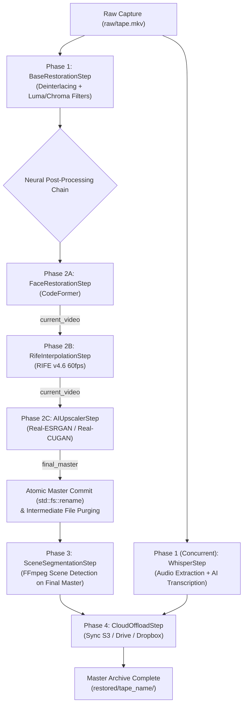

# 🎞️ Restoration Pipeline Technical Guide - VHS Studio Pro

This guide provides technical specifications for the Directed Acyclic Graph (DAG) orchestration engine, processing pipelines, motion-compensated deinterlacing algorithms, analog noise reduction filterchains, and multimodal neural network models implemented in **VHS Studio Pro**.

---

## 1. The Physics and Characteristics of Analog Video Signals

Restoring legacy magnetic tape media (VHS, S-VHS, Betamax, Video8, Hi8) requires domain-specific signal processing fundamentally distinct from typical digital format transcoding:

1. **Interlacing (Temporal Fields):** The analog video signal consists of 59.94 (NTSC) or 50 (PAL) temporal *fields* per second. Alternating odd and even horizontal scanlines were captured at distinct moments in time. Improper merging creates severe combing artifacts (*interlace combing*).
2. **Chroma Subcarrier Bandwidth Limitation (~0.6 MHz):** Color difference subcarrier bandwidth in VHS is restricted to roughly 0.6 MHz (compared to > 3.0 MHz for luminance). This results in prominent color bleeding, horizontal chroma delay, and high-frequency noise spikes (*rainbowing* / chroma noise).
3. **Mechanical Time Base Jitter (TBC Errors):** Mechanical imperfections in capstan motors, tape tension arms, and head drum rotation induce horizontal displacement (*line jitter* and *flagging* at the top of the raster).
4. **Cumulative Audio/Video Desynchronization:** Signal dropouts without a hardware Time Base Corrector cause capture devices to drop corrupted video frames while recording continuous audio, producing acute cumulative drift over a 2-hour capture.

---

## 2. Sequential Pipelined Chain & DAG Architecture (`src/domain/pipeline.rs`)

VHS Studio Pro implements a hybrid execution model: high-speed concurrent audio transcription running alongside a **Sequential Pipelined Chain** for cumulative video transformations:



### 2.1 State Accumulator & Graceful Degradation
To prevent the loss of upstream neural improvements, stages pass an accumulator variable `current_video`:

```rust
// Sequential Pipelined Chain for neural post-processing:
// BaseOutput -> FaceRestoration(current_video) -> RIFE(current_video) -> Upscaler(current_video)
let mut current_video = restoration_result.unwrap_or_else(|| self.output_path.clone());
let mut intermediate_files: Vec<String> = Vec::new();

for (step_name, enabled, step_fn) in post_step_specs {
    if !enabled {
        continue;
    }
    match step_fn(&current_video) {
        Ok(Some(step_out)) => {
            intermediate_files.push(current_video.clone());
            current_video = step_out;
        }
        Ok(None) => {
            tracing::warn!("[{step_name}] Returned no output; degrading gracefully with previous video.");
        }
        Err(err) => {
            tracing::warn!("[{step_name}] Step failed ({err}); degrading gracefully with previous video.");
        }
    }
}
```

- **Fail-Safe Boundary:** If an optional model fails (e.g. GPU out-of-memory or missing weights), the pipeline gracefully preserves the preceding video without crashing the studio.
- **Atomic Master Commit:** Once all stages complete, `os.replace` commits the final video to `self.output_path` in a single atomic filesystem operation.
- **Intermediate Artifact Purging:** Intermediate files recorded in `intermediate_files` are safely deleted, freeing disk space.
- **Deterministic Audio Cleanup:** The temporary uncompressed WAV file (`_temp.wav`) generated during Whisper transcription is enclosed in a `try ... finally` block, guaranteeing deletion even on unhandled errors or cancellations.

---

## 3. Motion-Compensated Deinterlacing Benchmark

The deinterlacing engine synthesizes interlaced fields into full-rate progressive frames (59.94p / 50p):

| Algorithm | Engine | Output Rate | Computational Complexity | Reconstruction & Motion Stability | Primary Use Case |
| :--- | :--- | :--- | :--- | :--- | :--- |
| **QTGMC (Slower/Slow)** | VapourSynth | 59.94p / 50p | Very High (Multi-core CPU) | **Reference Grade.** Motion-vector temporal smoothing, edge refinement, and complete elimination of bob shimmer. | **Archival Masters & Final Deliverables** |
| **QTGMC (Fast)** | VapourSynth | 59.94p / 50p | High | **Very Good.** Lower motion vector density while preserving temporal stability. | **Batch Archives / Mid-Range Workstations** |
| **bwdif** | Native FFmpeg | 59.94p / 50p | Moderate (1x–3x real-time) | **Good.** Direction-adaptive bob deinterlacing. Substantially superior to basic yadif. | **High-Speed Ingestion & Safe Fallback** |
| **znedi3 / nnedi3** | VapourSynth / FFmpeg | 59.94p / 50p | Moderate-High | **Specialized.** Neural directional interpolation for sharp edge recreation. | **High-Bandwidth S-VHS / TBC Captures** |

---

## 4. Analog Noise Reduction & Declarative Filterchain (`src/domain/filter_builder.rs`)

The FFmpeg filtergraph is generated through **pure, declarative functional composition** without global mutable state:

1. **Luma and Chroma Planar Separation & Realignment (`chromashift`):**
   - Corrects the horizontal and vertical phase delay inherent to the VHS "Color-Under" system (~629 kHz subcarrier), pulling color bleeding back into alignment with the high-frequency luminance ($Y$) edge data.
2. **HQDN3D (High-Quality 3D Denoise):**
   - Evaluates spatio-temporal noise variance across frames (`hqdn3d=3:2:6:4`), eliminating high-frequency analog snow without creating trailing ghosts (*ghosting*).
3. **Temporal Dropout Cleaner ([`DropoutCleaner`](file:///c:/Users/danie/Documents/vhs-capture-scripts-main/src/domain/dropout_cleaner.rs)):**
   - Applies `removegrain=1,tmedian=radius=1` to detect and eliminate single-frame white streaks caused by magnetic oxide flaking, replacing corrupted scanlines via temporal interpolation from adjacent fields.
4. **Overscan Blanking (12px Mask):**
   - Applies `drawbox=y=ih-12:color=black:width=iw:height=12:t=fill` across the bottom 12 scanlines containing helical head-switching noise, preventing flashing bars on digital flat panels without altering the 4:3 picture framing.
5. **3D Adaptive Comb Filtering (`dedot` / `TComb`):**
   - Suppresses cross-color rainbowing and cross-luminance dot crawl caused by composite video notch filtering during original recording.
6. **Audio Conditioning & Acoustic Restoration:**
   - **DC Offset Removal:** `dcshift=shift=0` removes bias voltage from analog capture cards.
   - **60Hz Mains Hum Notch Filter:** `anequalizer=c0 f=60 w=5 g=-30|c1 f=60 w=5 g=-30` cuts electrical hum induced by 110V/60Hz ground loops.
   - **FFT Spectral Denoise:** `afftdn=nr=12.0:nf=-50.0:tn=1` attenuates linear audio tape hiss without dulling high-frequency speech harmonics.
   - **Channel Balancing:** Automatic routing (`pan=stereo|c0=c0|c1=c0`) for camcorders recording solely to the Left audio track.

---

## 5. Multimodal Artificial Intelligence Suite

### 5.1 Blind Face Restoration (CodeFormer)
- Restores facial landmarks, iris definition, and lip contours degraded by VHS low horizontal resolution (~240 lines).
- Configurable fidelity weighting (`ai_face_fidelity` between `0.1` and `0.9`) strikes the optimal balance between natural historical likeness and clarity enhancement, preventing waxy synthetic skin textures.

### 5.2 Optical Flow Motion Interpolation (RIFE v4.6)
- Employs deep bidirectional optical flow networks to generate smooth transitions in 25p/30p material targeted for 60fps presentation without telecine judder.

### 5.3 Deep Convolutional Super-Resolution (Real-ESRGAN / Real-CUGAN)
- **Real-ESRGAN x4plus:** Focuses on sharp edge delineation, crisp typography, and textural definition.
- **Real-CUGAN (`models-se`):** Optimized for retaining organic film grain and subtle analog gradations.

### 5.4 Acoustic Speech Recognition & Subtitling (Faster-Whisper)
- Audio extraction normalized to broadcast LUFS standards.
- 100% offline neural transcription with automatic language identification.
- Produces synchronized `.vtt` (Web Video Text Tracks) for browser rendering and `.srt` (SubRip) for professional NLE suites.

---

## 6. Canonical Studio Presets

Restoration configurations are mapped to four core profiles in [`vhs_advanced_config.toml`](file:///c:/Users/danie/Documents/vhs-capture-scripts-main/vhs_advanced_config.toml):

| Preset | ID | Filter & Codec Configuration | Operational Objective |
| :--- | :--- | :--- | :--- |
| **Broadcast Standard** | `gold` | QTGMC Slow (60p) + ProRes 422 / H.264 CRF 18 + TBC Passthrough | Reference archival master for heritage collections and precious family tapes. |
| **Hardware Ultrafast** | `speed` | BWDIF (60p) + NVENC / AMF / QSV CRF 22 + Lanczos 1080p | High-throughput batch transfer (300+ fps processing rate). |
| **TBC Frame-Hold** | `tbc_hold` | Frame-Hold Dropout Shield + ZNEDI3 + Mono-L JVC | Salvaging damaged, creased, or severely out-of-sync tapes. |
| **AI Master** | `ai_master` | QTGMC + Real-ESRGAN x4plus + CodeFormer + Faster-Whisper | Comprehensive 4K digital restoration for modern large displays. |

---

## 7. Real-Time Process Control (Pause, Resume & Safe Abort)

Long restoration runs (tapes spanning 2 to 6 hours) require deterministic operational control:

- **Non-Destructive Pause (`POST /api/action {"action": "pause_process"}`):**
  - Sends operating system thread suspension signals (`SuspendThread` on Windows, `SIGSTOP` on POSIX).
  - CPU and GPU utilization drops to 0% immediately, allowing the host system to perform critical tasks without aborting or desynchronizing video buffers.
- **Instant Resume (`POST /api/action {"action": "resume_process"}`):**
  - Resumes the process tree (`ResumeThread` / `SIGCONT`), continuing from the exact frame where it paused.
- **Safe Abort (`POST /api/action {"action": "abort_process"}`):**
  - Cascades termination signals through all child worker processes and releases file locks, preventing frozen ports and damaged output headers.

---

## 8. Incomplete Job Recovery Subsystem

In the event of unexpected power loss or system restarts during digitization:

- **Automatic Residual Detection:** The backend detects unfinished files ending in `.tmp.mp4` or `.tmp.mkv` in `media/restored/` and evaluates recovered frame counts.
- **Recovery Actions (`POST /api/restoration/incomplete/action`):**
  1. **`resume`**: Continues the restoration job from the last recorded frame checkpoint.
  2. **`finalize`**: Uses FFmpeg stream-copy mode (`-c copy -movflags +faststart`) to rewrite the container indices and relocate the `moov` atom to the file header, making the partial video immediately playable and editable.
  3. **`discard`**: Removes orphaned temporary files and reclaims storage space.

---

## 9. Integrated GPU (UMA) Optimization & Thermal Throttling Prevention

On workstations featuring integrated graphics architectures (Intel UHD Graphics 770 / Iris Xe / AMD Radeon):

1. **Unified Memory Architecture (UMA):** System RAM and VRAM share the same physical memory channels. Rather than incurring PCIe bus transfer overhead, input video decoding remains in multi-threaded software within host memory.
2. **Real-ESRGAN via Vulkan NCNN (`-g 0`):** Allocates tensor buffers directly into shared unified memory accessible by the iGPU's Execution Units.
3. **Fixed-Function Silicon Encoders:** Intel QuickSync (`h264_qsv` / `hevc_qsv`) and AMD AMF encode video using dedicated ASIC hardware, leaving CPU cores available for compute-heavy QTGMC deinterlacing.
4. **Whisper Thread Balancing:** Concurrency is constrained to 4–8 worker threads to prevent sustained 100% CPU saturation and avoid thermal throttling.

---

## 10. Direct Panasonic DVR Ingestion (MEIHDFS)

To extract recordings directly from Panasonic DMR hard drives:
- USB-to-SATA bridge controllers (**JMicron JMS567**, **ASMedia**, **Realtek**) and raw block devices are automatically detected.
- Native C utilities ([`extract_meihdfs`](file:///c:/Users/danie/Documents/vhs-capture-scripts-main/tools/panasonic_rec/extract_meihdfs.exe) and [`dvd-vr`](file:///c:/Users/danie/Documents/vhs-capture-scripts-main/tools/panasonic_rec/dvd-vr.exe)) parse proprietary inodes and demux MPEG-2 Program Streams at maximum disk read speeds.
- For complete operational guidance, consult the [Panasonic DVR Ingest Technical Manual](file:///c:/Users/danie/Documents/vhs-capture-scripts-main/docs/PANASONIC_DVR_GUIDE.md).

---

## 11. Automated Tape Quality Control & Defect Diagnostics (`src/domain/qc.rs`)

Before or after restoration, operators can trigger forensic technical diagnostics on any media file in `media/raw/` or `media/restored/` using the [`QualityControl`](file:///c:/Users/danie/Documents/vhs-capture-scripts-main/src/domain/qc.rs) subsystem:

```bash
# Execute deep QC inspection on a tape capture
cargo run -- qc-report media/raw/tape_01.mkv
```

### 11.1 Diagnostic Measurements Performed
1. **Unrecorded Leader Detection (`find_first_video_frame`):** Measures the initial black/static lead-in segment ($\bar{Y} \le 18.0$) to calculate the precise frame offset for audio/video synchronization.
2. **Interlace & Cadence Analysis (`idet`):** Probes 300 temporal fields to determine whether the capture contains active interlaced fields (`TFF`/`BFF`) or has already been progressive-scanned, selecting the optimal deinterlacing engine automatically.
3. **Audio Channel Layout & Decibel Probing (`astats`):** Measures independent channel RMS levels ($L$ vs $R$). If one channel is dead (e.g. $R \le -55\text{ dB}$ while $L \ge -45\text{ dB}$), it automatically flags mono unbalanced recording.
4. **Temporal Outlier Dropout Detection (`signalstats`):** Computes `TOUT` (Temporal Outliers), detecting white streak bursts from magnetic oxide loss and dirt.
5. **Head Switching Noise Probing:** Measures variance in the bottom 16 scanlines ($464–480\text{px}$) to confirm whether overscan blanking is needed.

### 11.2 Output Reports Generated
- `<file>_qc_report.json`: Structured metadata and defect metrics for CI/CD or batch validation.
- `<file>_defect_report.md`: Complete forensic report mapping each observed flaw, its affected timecode interval, the physical root cause on tape, and the recommended/applied filter.


