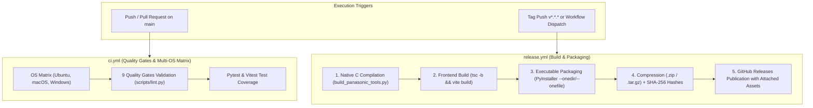

# 📦 Release Pipeline, CI/CD & Cross-Platform Packaging

<div align="justify">

This document details the Continuous Integration (CI) and Continuous Delivery (CD) architecture of **VHS Studio Pro**, including automated quality gates, native C binary compilation, desktop packaging via PyInstaller, and cryptographic release artifact generation.

</div>

---

## 1. GitHub Actions Workflows Overview (`.github/workflows/`)

<div align="justify">

The repository incorporates two automated workflows managed via GitHub Actions:

</div>



---

## 2. Native C Toolchain Compilation (`build_panasonic_tools.py`)

<div align="justify">

Prior to generating application distributions, low-level Panasonic filesystem recovery utilities (`extract_meihdfs`, `dvd-vr`, `vro2split`, `udf_dump`) are compiled natively inside each runner:

</div>

| Operating System | Compiler Toolchain | Optimization Flags | Output Binaries in `tools/panasonic_rec/` |
| :--- | :--- | :--- | :--- |
| **Windows (`windows-latest`)** | MinGW GCC / MSVC | `-O2 -s` | `extract_meihdfs.exe`, `dvd-vr.exe`, `vro2split.exe`, `udf_dump.exe` |
| **Linux (`ubuntu-latest`)** | GNU GCC | `-O2 -s` | `extract_meihdfs`, `dvd-vr`, `vro2split`, `udf_dump` |
| **macOS (`macos-latest`)** | Apple LLVM / Clang | `-O2` | `extract_meihdfs`, `dvd-vr`, `vro2split`, `udf_dump` (Mach-O) |

<div align="justify">

[`scripts/build_panasonic_tools.py`](file:///c:/Users/danie/Documents/vhs-capture-scripts-main/scripts/build_panasonic_tools.py) automatically identifies the compiler present in the host environment and generates executable binaries with robust error handling.

</div>

---

## 3. React Frontend Compilation (Node.js 24)

<div align="justify">

The frontend application built with **React 19, Vite, Tailwind CSS v4, and Lucide Icons** is compiled into a production bundle:

```bash
npm --prefix ui ci
npm --prefix ui run build
```

- The runner environment specifies `ACTIONS_RUNNER_FORCE_NODE24: "true"` to guarantee compatibility with modern GitHub Actions workflows.
- The compiled static bundle in `ui/dist/` is bundled directly into the standalone application package, allowing the desktop GUI and local web server to run completely offline without requiring Node.js on end-user machines.

</div>

---

## 4. Standalone Application Packaging with PyInstaller

<div align="justify">

The distribution package is assembled via PyInstaller utilizing the specification definition and command arguments:

```bash
pyinstaller --noconfirm --onedir --windowed \
  --name "vhs-studio-pro" \
  --add-data "ui/dist${SEP}ui/dist" \
  --add-data "tools/panasonic_rec${SEP}tools/panasonic_rec" \
  --add-data "src/vhs_studio${SEP}vhs_studio" \
  src/vhs_studio/cli/main.py
```
*(Where `${SEP}` is the OS-specific path separator: `;` on Windows and `:` on Linux/macOS).*

### Critical Bundled Assets:
- `ui/dist`: Contains pre-compiled HTML, CSS, JavaScript, and i18n locale dictionaries.
- `tools/panasonic_rec`: Contains compiled native C binaries for the target operating system.
- `vhs_advanced_config.toml`: Contains canonical signal processing constants and presets.

</div>

---

## 5. Cryptographic Supply-Chain Fixity (SHA-256)

<div align="justify">

To guarantee package integrity and prevent in-transit tampering:

1. Every compressed archive artifact (`vhs-studio-pro-windows-x64.zip`, `vhs-studio-pro-linux-x64.tar.gz`, `vhs-studio-pro-macos-x64.zip`) generates a matching SHA-256 cryptographic digest:
   ```bash
   sha256sum vhs-studio-pro-windows-x64.zip > vhs-studio-pro-windows-x64.zip.sha256
   ```
2. Checksum files are published alongside release binaries on GitHub Releases.
3. Operators can verify their download with a single command:
   ```bash
   sha256sum -c vhs-studio-pro-windows-x64.zip.sha256
   ```

</div>
