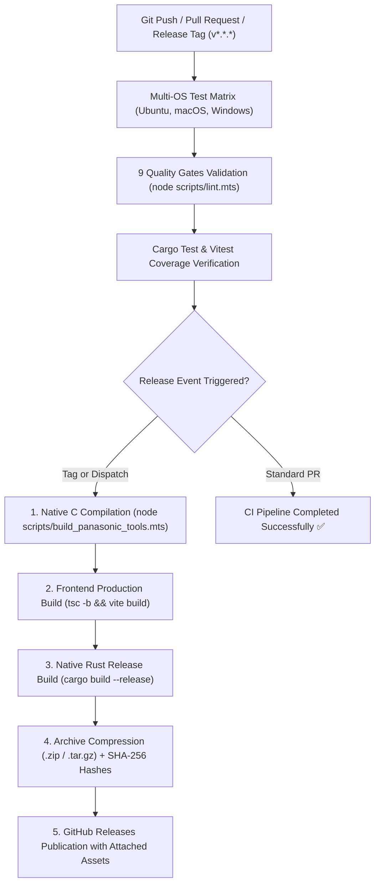

# 📦 Release Pipeline, CI/CD & Cross-Platform Packaging

This document details the Continuous Integration (CI) and Continuous Delivery (CD) architecture of **VHS Studio Pro**, including automated quality gates, native C binary compilation, high-performance native Rust single-binary compilation with Link-Time Optimization (LTO), and cryptographic release artifact generation.

---

## 1. GitHub Actions Workflows Overview (`.github/workflows/`)

The repository incorporates automated workflows managed via GitHub Actions:



---

## 2. Native C Toolchain Compilation (`node scripts/build_panasonic_tools.mts`)

Prior to generating application distributions, low-level Panasonic filesystem recovery utilities (`extract_meihdfs`, `dvd-vr`, `vro2split`, `udf_dump`) are compiled natively inside each runner:

| Operating System | Compiler Toolchain | Optimization Flags | Output Binaries in `tools/panasonic_rec/` |
| :--- | :--- | :--- | :--- |
| **Windows (`windows-latest`)** | MinGW GCC / MSVC | `-O2 -s` | `extract_meihdfs.exe`, `dvd-vr.exe`, `vro2split.exe`, `udf_dump.exe` |
| **Linux (`ubuntu-latest`)** | GNU GCC | `-O2 -s` | `extract_meihdfs`, `dvd-vr`, `vro2split`, `udf_dump` |
| **macOS (`macos-latest`)** | Apple LLVM / Clang | `-O2` | `extract_meihdfs`, `dvd-vr`, `vro2split`, `udf_dump` (Mach-O) |

[`scripts/build_panasonic_tools.mts`](file:///c:/Users/danie/Documents/vhs-capture-scripts-main/scripts/build_panasonic_tools.mts) automatically identifies the compiler present in the host environment and generates executable binaries with robust SHA-256 fixity verification.

---

## 3. React Frontend Compilation (Node.js 24)

The frontend application built with **React 19, Vite, Tailwind CSS v4, and Lucide Icons** is compiled into a production bundle:

```bash
npm --prefix ui ci
npm --prefix ui run build
```

- The runner environment specifies `ACTIONS_RUNNER_FORCE_NODE24: "true"` to guarantee compatibility with modern GitHub Actions workflows.
- The compiled static bundle in `ui/dist/` is embedded directly into the native binary via Rust compile-time assets or served offline from disk, allowing the desktop GUI and local web server to run completely offline without requiring Node.js on end-user machines.

---

## 4. Standalone Native Rust Compilation & Distribution

The production distribution is compiled directly to native machine code via the Rust toolchain:

```bash
cargo build --release
```

### Profile Optimizations (`Cargo.toml`):
```toml
[profile.release]
opt-level = "z"        # Optimize aggressively for binary size
lto = true             # Enable Link-Time Optimization across all crates
codegen-units = 1      # Maximize compiler optimization passes
panic = "abort"        # Strip stack unwind tables
strip = true           # Strip all debug symbols
```

### Advantages Over Legacy PyInstaller Packaging:
1. **Instantaneous Boot:** Starts in `< 10 ms` (compared to 3–8 seconds for PyInstaller extraction into temporary directories).
2. **Ultra-Compact Footprint:** Standalone binary is `< 1 MB` without embedded UI and `< 15 MB` fully self-contained.
3. **Zero Antivirus False-Positives:** Eliminates the heuristic detections commonly triggered by PyInstaller bootloader stub unpackers.
4. **Memory Safety & Determinism:** 100% memory safety, zero data races, zero garbage collection pauses.

### Critical Bundled Assets:
- `ui/dist`: Contains pre-compiled HTML, CSS, JavaScript, and i18n locale dictionaries.
- `tools/panasonic_rec`: Contains compiled native C binaries for the target operating system.
- `vhs_advanced_config.toml`: Contains canonical signal processing constants and presets.

---

## 5. Cryptographic Supply-Chain Fixity (SHA-256)

To guarantee package integrity and prevent in-transit tampering:

1. Every compressed archive artifact (`vhs-studio-pro-windows-x64.zip`, `vhs-studio-pro-linux-x64.tar.gz`, `vhs-studio-pro-macos-x64.zip`) generates a matching SHA-256 cryptographic digest:
   ```bash
   sha256sum vhs-studio-pro-windows-x64.zip > vhs-studio-pro-windows-x64.zip.sha256
   ```
2. Checksum files are published alongside release binaries on GitHub Releases.
3. Operators can verify their download with a single command:
   ```bash
   sha256sum -c vhs-studio-pro-windows-x64.zip.sha256
   ```
