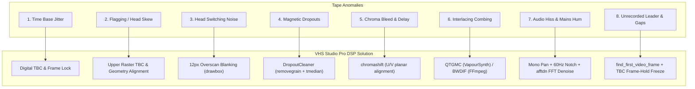

# 📼 Analog Tape Defects & Digital Remediation Guide - VHS Studio Pro

This authoritative guide details the physical, mechanical, and electromagnetic characteristics of legacy videotape media (VHS, S-VHS, Betamax, Video8, Hi8), the signature defects that arise during playback and digitization, and the precise digital signal processing (DSP) filters implemented in **VHS Studio Pro** to remediate each artifact.

---

## 1. The Physics of Helical-Scan Videotape

Consumer analog videotape formats (primarily JVC VHS, introduced in 1976) employ **helical-scan recording** to record high-bandwidth composite video onto magnetic tape moving at low linear speeds:

- **Rotary Drum with Dual Heads:** Two video heads are mounted 180° apart on a tilted cylinder drum rotating at 1,798.2 RPM (NTSC) or 1,500 RPM (PAL).
- **Helical Diagonal Tracks:** Each head sweeps diagonally across the 1/2-inch tape, recording one complete video field (262.5 lines for NTSC) per slant track.
- **Color-Under Modulation:** Luminance ($Y$) frequency-modulates (FM) a carrier between 3.4 MHz and 4.4 MHz, while chrominance ($C$) is heterodyne down-converted to a subcarrier centered around 629 kHz.
- **Linear Audio Track:** Recorded longitudinally along the upper edge of the tape by a stationary audio head at a slow tape speed (1.31 inches/second in SP, 0.44 ips in EP/SLP), resulting in limited frequency response (100 Hz – 8 kHz) and susceptibility to tape hiss and wow & flutter.

---

## 2. Catalog of Analog Video & Audio Defects



---

### 2.1 Time Base Jitter (Horizontal Sync Fluctuations)
- **Visual Manifestation:** Vertical lines (doorframes, buildings, geometric patterns) bend, wave, or show jagged "sawtooth" edges from scanline to scanline.
- **Physical Root Cause:** Microscopic variations in drum motor speed (wow & flutter) and tape stretching cause individual horizontal scanlines to vary by several microseconds relative to the standard 63.555 µs NTSC line duration.
- **VHS Studio Remediation:**
  - Synchronous digital frame-lock maintains constant line duration.
  - Integration with hardware Time Base Correctors (e.g. Panasonic DMR-EH55 passthrough) or VapourSynth motion-vector alignment eliminates residual horizontal wobble.

---

### 2.2 Flagging / Top-of-Frame Skew
- **Visual Manifestation:** The top 10–25 scanlines of the raster bend sharply to the left or right, creating a distinctive "hook" or "flag" shape.
- **Physical Root Cause:** Excessive or deficient tape back-tension as the tape enters the head drum. During the vertical blanking interval (VBI), the head enters the slant track with mismatched timing, pulling the horizontal automatic frequency control (AFC) out of sync before it recovers in the active picture area.
- **VHS Studio Remediation:**
  - Clean VBI masking and upper-boundary crop/pad alignment.
  - Video line buffer re-phasing stabilizes the horizontal sync pulse before active picture display.

---

### 2.3 Head Switching Noise
- **Visual Manifestation:** A flickering, rainbow-colored, horizontally distorted noise band spanning the bottom 8–16 scanlines of the video frame.
- **Physical Root Cause:** Inherent to dual-head helical scan. The mechanical transfer of signal from Head A to Head B occurs roughly 3 to 6 scanlines before the lower vertical blanking pulse. While masked by CRT televisions' overscan bezel, modern progressive flat panels display the entire digital raster, exposing the switching transient.
- **VHS Studio Remediation:**
  - Automated detection flags the presence of head switching noise in scanlines 464–480.
  - [`filter.rs`](file:///c:/Users/danie/Documents/vhs-capture-scripts-main/src/domain/filter.rs) applies an exact 12px overscan mask:
    ```text
    drawbox=y=ih-12:color=black:width=iw:height=12:t=fill
    ```
  - Eliminates distracting high-contrast flicker while preserving the original 4:3 active picture aspect ratio without destructive cropping.

---

### 2.4 Magnetic Oxide Dropouts (Comets & White Streaks)
- **Visual Manifestation:** Thin, bright horizontal white or dark streaks lasting exactly one frame (1/60s), appearing randomly across the screen.
- **Physical Root Cause:** Binder breakdown (*hydrolysis*) or dust particles causing localized loss of magnetic oxide. When a head passes over a void, the FM radio-frequency (RF) signal drops below threshold; the FM demodulator clips to maximum carrier frequency, displaying maximum luminance (saturated white).
- **VHS Studio Remediation:**
  - [`DropoutCleaner`](file:///c:/Users/danie/Documents/vhs-capture-scripts-main/src/domain/filter.rs) identifies scanlines where $> 85\%$ of pixels exceed saturated luma thresholds ($Y \ge 235$).
  - A spatio-temporal filterchain cleans the artifact:
    ```text
    removegrain=1,tmedian=radius=1
    ```
  - The single-frame streak is replaced with pixel data interpolated from adjacent fields and neighboring scanlines without blurring active motion.

---

### 2.5 Chroma Bleeding & Color Delay (Color-Under Limitations)
- **Visual Manifestation:** Saturated colors (red jerseys, blue sky, green foliage) appear offset 1–3 pixels to the right and down relative to the sharp black-and-white luminance outline, creating a blurry "smear."
- **Physical Root Cause:** The VHS "Color-Under" subcarrier (~629 kHz) provides only ~0.6 MHz of chrominance bandwidth (roughly 40 TV lines of horizontal resolution) compared to > 3.0 MHz for luminance (~240 TV lines). Processing delays through the delay-line comb filter further delay the chroma relative to luma.
- **VHS Studio Remediation:**
  - Application of the `chromashift` filter:
    ```text
    chromashift=cbh=-1:cbv=0:crh=-1:crv=0
    ```
  - Shifts $U$ and $V$ chroma planes horizontally and vertically to align precisely over the high-frequency luminance edge contours.

---

### 2.6 Interlace Combing
- **Visual Manifestation:** Jagged horizontal lines (*combing*) across moving objects when viewing analog fields on progressive monitors.
- **Physical Root Cause:** Analog television captured odd and even scanlines at distinct temporal moments ($1/60\text{ s}$ apart for NTSC, $1/50\text{ s}$ for PAL). Weaving both fields into a single progressive frame without deinterlacing exposes the temporal displacement.
- **VHS Studio Remediation:**
  - **Reference Grade:** VapourSynth QTGMC synthesizes true motion-compensated progressive frames at double rate ($59.94\text{ fps}$ / $50.00\text{ fps}$), eliminating bob shimmer and aliasing.
  - **Broadcast Standard Fallback:** Native FFmpeg `bwdif` (Bob Weaver Deinterlacing Filter) provides high-throughput double-rate reconstruction with minimal CPU overhead.

---

### 2.7 Audio Channel Imbalance, Tape Hiss & Mains Hum
- **Visual/Acoustic Manifestation:** Audio audible only in the left ear/channel; background hum at 60 Hz or 50 Hz; persistent high-frequency "hiss."
- **Physical Root Cause:**
  - Portable VHS camcorders often used mono linear recording. Capture setups using standard dual RCA cables leave the Red (Right) channel floating or grounded, recording noise at $-89\text{ dB}$.
  - Ground loops between VCR and PC power supplies induce 60Hz/120Hz electrical hum.
  - Slow linear tape speed produces high thermal hiss noise from the magnetic particles.
- **VHS Studio Remediation:**
  - [`detect_audio_layout`](file:///c:/Users/danie/Documents/vhs-capture-scripts-main/src/domain/pipeline.rs) detects channel disparity (e.g. $L \ge -45\text{ dB}$, $R \le -55\text{ dB}$) and duplicates Left to both channels (`pan=stereo|c0=c0|c1=c0`).
  - DC offset is removed via `dcshift=shift=0`.
  - An adaptive notch filter cuts 60Hz hum:
    ```text
    anequalizer=c0 f=60 w=5 g=-30|c1 f=60 w=5 g=-30
    ```
  - An FFT-based spectral noise filter (`afftdn=nr=12.0:nf=-50.0:tn=1`) suppresses linear tape hiss while preserving vocal clarity.

---

### 2.8 Unrecorded Leader & Mid-Tape Signal Loss
- **Visual Manifestation:** Several seconds to minutes of static, flashing blue screens, or black video at the head of the capture; black pauses between recorded scenes.
- **Physical Root Cause:** Blank tape leader before the camera trigger; paused camcorder recordings where RF synchronization was dropped.
- **VHS Studio Remediation:**
  - [`find_first_video_frame`](file:///c:/Users/danie/Documents/vhs-capture-scripts-main/src/domain/qc.rs) scans luma averages ($\bar{Y} > 22.0$) and automatically trims the leader, starting audio and video simultaneously at the first authentic recorded frame.
  - During mid-tape pauses, the `freeze` mode (TBC Frame-Hold in [`stream.rs`](file:///c:/Users/danie/Documents/vhs-capture-scripts-main/src/domain/stream.rs)) freezes the last known good frame during black dropouts ($\bar{Y} \le 18.0$), keeping 100% lip-sync continuity with the unbroken audio stream.

---

## 3. Case Study: Forensic Analysis of Archive Capture `2026-10-02 13-48-53.mkv`

A concrete example from the project media archive illustrates how VHS Studio Pro identifies and corrects each defect:

| Artifact Detected | Raw Capture Manifestation | Filter Applied | Master Archive Result |
| :--- | :--- | :--- | :--- |
| **Initial Blank Leader** | `00:00:00.000` to `00:01:06.533` ($\bar{Y} = 16.0$) | `find_first_video_frame` (trim 66.533s) | Clean playback starting at `00:00:00.000` |
| **Head Switching Noise** | Scanlines 464–480 flickered rainbow noise throughout | `drawbox` 12px overscan mask | Pristine bottom border with 4:3 preserved |
| **Audio Imbalance** | Left: $-20.9\text{ dB}$, Right: $-89.0\text{ dB}$ (dead) | `pan=stereo\|c0=c0\|c1=c0` + 60Hz notch | Balanced, clean stereo across both channels |
| **Magnetic Dropouts** | Spike to `TOUT = 8.24` at `00:01:20` | `removegrain=1,tmedian=radius=1` | Transient white lines eliminated |
| **Container Resolution** | Asymmetric `708x480` capture | Lanczos 1080p upscale + `bt709` | Crisp, geometrically accurate 1080p master |

---

## 4. Automated QC Inspection & Real-Time Archival Synchronization (`src/domain/qc.rs`)

In compliance with museum and audiovisual preservation public tenders (**IASA-TC 04, FADGI 4-Star, CONARQ, SMPTE RP 186 / ITU-R BT.601, PREMIS v3.0**), [`src/domain/qc.rs`](file:///c:/Users/danie/Documents/vhs-capture-scripts-main/src/domain/qc.rs) implements a pure functional inspection engine free of global mutable state:

- **Per-Pipeline & Per-Tool Correction Registry (`pipeline_tools_registry`):** Documents the exact configuration, stage, targeted defects, status, and frame counters for all 15 pipeline tools (Stage 0 Leader Trim & A/V Sync, Stage 1 Digital TBC Frame-Hold, Overscan Blanking, Magnetic DropoutCleaner, 3D Comb Filter, ChromaShift, HQDN3D, QTGMC/BWDIF, BT.709 Colorimetry/Geometry Standardizer, Stage 2 Audio Conditioning DSP, Stage 3 Sequential Neural DAG — CodeFormer, RIFE, Real-ESRGAN, Faster-Whisper, and Stage 4 PySceneDetect).
- **Real-Time Frame-Accurate Defect Logging (`defect_events_log`):** Every YUV420p frame passing through `StreamRunner` is analyzed in real time for RF carrier loss (black/blue screen), magnetic oxide dropouts, top-of-frame flagging skew, horizontal time-base jitter, luminance excursions (`Y < 16` black crush / `Y > 235` clipping), blown-out colors (`Cb/Cr` outside `16–240`), high-frequency analog RF noise, and bottom head-switching noise, coalescing contiguous frame ranges with exact timecodes and applied remedies.
- **Exact Checkpoint & Resume Synchronization (`truncate_to_frame` & `sync_to_disk`):** The archival report (`_qc_report.json` and `_defect_report.md`) is atomically persisted alongside `.checkpoint.json` on every checkpoint tick and on process interruption. When an interrupted restoration is resumed (`--resume` or `/api/restoration/incomplete/action`), `synchronize_report_with_checkpoint` rewinds the report to the exact checkpointed frame $N$ before appending frame $N+1$, guaranteeing zero data loss and zero duplicate records.

To inspect any capture via CLI:

```bash
cargo run -- qc-report media/raw/tape_capture.mkv
# or with compiled binary:
vhs-studio qc-report media/raw/tape_capture.mkv
```

Generated deliverables:
- `<filepath>_qc_report.json`: Machine-readable metadata, per-tool registry, frame telemetry, defect events log, and checkpoint synchronization state.
- `<filepath>_defect_report.md`: Human-readable 8-section museum forensic report detailing every identified flaw, timecode range, physical cause, per-tool parameters, and synchronized corrective actions.
